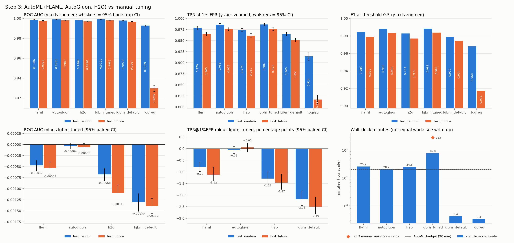

# Step 3 write-up: AutoML (FLAML, AutoGluon, H2O) versus manual tuning

_Generated by `src/automl_writeup.py` from the Step 3 tables and the artefacts in `reports/leaderboards/` (runs: 20261028T080109Z-d9f409, 20261029T014020Z-210e44). Do not edit by hand: rerun `scripts/run_automl.py --tables-only` to regenerate it._

## Setup: what was the same and what was not

Same for every tool: the persisted `train` split (160,000 rows x 2,568 float32 features,
named `family__i` so importances group by EMBER feature family), optimisation metric ROC-AUC,
16 threads, a search budget of 1200 s, and the tools ran one after another in separate
processes with no other heavy job running. Seed 42 was passed wherever a tool takes one, but not every
random choice inside the tools follows it (see "Seeds actually used"). Neither test set was loaded before a
tool's fit had finished; every leaderboard and importance below comes from the tool's own internal validation
on `train`.

Each tool chose its own validation inside `train`, and so used the 160,000 rows differently:

* FLAML: holdout of 0.1 of the rows (about 16,000 rows), then the winner is retrained on all rows (`retrain_full=True`).
* AutoGluon: holdout split of train made by AutoGluon (no bagging or stacking in medium_quality); 2,496 validation rows, so its models trained on the other 157,504 rows; no refit on all rows.
* H2O AutoML: no cross-validation (H2O's automatic choice, nfolds=None): it split train into frames of training 112,141, validation 16,092, blending 31,767 rows; models train on the training frame only and the leaderboard is scored on the validation frame; no refit on all rows.

Seeds actually used (read back from the saved models by `src/automl_checks.py`):

* FLAML: search `seed=42`; FLAML's holdout split uses its own fixed `flaml.config.RANDOM_SEED=1`, and the winning model kept FLAML's default `random_state=10242048`.
* AutoGluon: train/validation split `random_state=42`; its 6 models used `random_seed` 0 (AutoGluon's default). AutoGluon takes a per-model `random_seed` only inside `hyperparameters`, which this run did not set.
* H2O AutoML: `seed=42` passed to `H2OAutoML`, which seeds its models and its frame split from it. H2O documents that a run limited by `max_runtime_secs` (as here) is not exactly reproducible even with a seed, because how many models fit in the time depends on the machine.

Manual tuning (Step 2) is different in kind: 36 LightGBM configurations per tuner, each scored by
3-fold CV on a 60,000-row subset of `train`; the best configuration (here `optuna`,
picked by mean CV AUC, never by a test score) was then refit on all of `train`. In the tables below this
model is called `lgbm_tuned`.

## What each tool tried and what won

### FLAML

FLAML searched 8 estimator types with 105 trials in total (from
`leaderboards/flaml_search_log.json`). It starts each learner on a small sample of rows and grows
the sample for promising ones, so "sample" below is the number of rows of the best trial. Every estimator in FLAML's list got at least one trial.

| estimator | trials | best validation AUC | sample (rows) | seconds in trials | note |
|---|---|---|---|---|---|
| xgb_limitdepth | 17 | 0.9985 | 144,000 | 242 | - |
| extra_tree | 26 | 0.9968 | 144,000 | 155 | - |
| lgbm | 25 | 0.9955 | 10,000 | 242 | never past 10,000-row samples |
| catboost | 2 | 0.9942 | 10,000 | 315 | never past 10,000-row samples |
| xgboost | 11 | 0.9933 | 10,000 | 58 | never past 10,000-row samples |
| rf | 20 | 0.9883 | 10,000 | 17 | never past 10,000-row samples |
| sgd | 3 | 0.8099 | 10,000 | 36 | never past 10,000-row samples |
| lrl1 | 1 | 0.5018 | 10,000 | 298 | never past 10,000-row samples; 1 trial only; no better than chance |

FLAML's own log estimated at the start: "Estimated sufficient time budget=212962s. Estimated necessary time budget=5250s." The 1200 s budget is 4.4 times below the "necessary" estimate, so only `xgb_limitdepth`, `extra_tree` reached the full 144,000-row sample; the other 6 learners were only ever compared on small samples. Their rows say little about how they would do on this data with more time.

Winner: `xgb_limitdepth` (validation AUC 0.9985, found after
996 s), config `{"colsample_bylevel": 0.9761142820940875, "colsample_bytree": 1.0, "learning_rate": 0.32423092828827804, "max_depth": 9, "min_child_weight": 1.7602924214359448, "n_estimators": 73, "reg_alpha": 0.0009765625, "reg_lambda": 40.467095481310615, "subsample": 0.8688926732048341}`.

Overrun: FLAML passes the remaining budget to each trial; its boosting learners (LightGBM, XGBoost, CatBoost) stop at that deadline, but scikit-learn learners such as logistic regression cannot be interrupted inside one fit. The last trial (`lrl1`, 298 s, a fit that cannot be interrupted) started at 1164 s, before the 1200 s budget was used up, and ended at 1462 s; this one trial is most of FLAML's overrun. The longest trial of the search was `catboost` (300 s, validation AUC 0.9942). Then it retrained `xgb_limitdepth` on all rows for 80 s.

### AutoGluon

`medium_quality` preset: one holdout split, no bagging or stacking, base models fitted one after another until
the time runs out, then a weighted ensemble of them. 5 base models were started;
6 of the 11 planned base models were never started (no time left). `CatBoost` got only the time that was left and stopped early, so its score says little about that model family on this data.

| model | validation AUC | fit seconds (cumulative) | note |
|---|---|---|---|
| LightGBMXT | 0.9994 | 394 | - |
| WeightedEnsemble_L2 | 0.9994 | 394 | fit seconds include its base models; own fit 0.09 s |
| LightGBM | 0.9992 | 298 | - |
| RandomForestEntr | 0.9981 | 162 | - |
| RandomForestGini | 0.9979 | 256 | - |
| CatBoost | 0.9930 | 53 | stopped by the time limit at iteration 114 |

Winner: `WeightedEnsemble_L2` (validation AUC 0.9994); ensemble weights:
`LightGBMXT` 1.00. AutoGluon fitted every model with its preset hyperparameters (`hyperparameters='default'`; medium_quality does no hyperparameter search), so `LightGBMXT` is LightGBM with `extra_trees=True` and otherwise AutoGluon's default settings.

### H2O AutoML

H2O trained 9 models (GBM 4, StackedEnsemble 3, DRF 1, GLM 1). Validation: no cross-validation (H2O's automatic choice, nfolds=None): it split train into frames of training 112,141, validation 16,092, blending 31,767 rows; models train on the training frame only and the leaderboard is scored on the validation frame.
XGBoost is not available in H2O on Windows, so H2O's default plan ran without it. Event log on XGBoost: "AutoML: XGBoost is not available; skipping it." Out of time, H2O also skipped these planned steps: `DRF XRT (Extremely Randomized Trees)`, `GBM def_1`, `DeepLearning def_1`, `GBM grid_1`, `DeepLearning grid_1`, `DeepLearning grid_2`, `DeepLearning grid_3`, `GBM lr_annealing`, `completion resume_best_grids`, and 13 further stacked ensembles. Most of the budget went to `GLM_1` (519 s, 43% of the budget) and `GBM_1` (454 s, 38% of the budget).

| model (suffix _AutoML_... dropped) | algorithm | leaderboard AUC | training seconds |
|---|---|---|---|
| StackedEnsemble_BestOfFamily_1 | StackedEnsemble | 0.9984 | 27 |
| StackedEnsemble_BestOfFamily_2 | StackedEnsemble | 0.9984 | 18 |
| StackedEnsemble_AllModels_1 | StackedEnsemble | 0.9984 | 35 |
| GBM_1 | GBM | 0.9984 | 454 |
| DRF_1 | DRF | 0.9942 | 39 |
| GBM_4 | GBM | 0.9929 | 33 |
| GBM_3 | GBM | 0.9919 | 35 |
| GBM_2 | GBM | 0.9912 | 35 |
| GLM_1 | GLM | 0.9878 | 519 |

Leader: `StackedEnsemble_BestOfFamily_1_AutoML_1_20261029_80743` (stackedensemble, leaderboard AUC 0.9984).
Its GLM metalearner (non-negative weights: True) gives the base models the weights `GBM_1` 1.117, `GLM_1` 0.000, so the leader is in effect `GBM_1` passed through a logistic calibration, not a blend of models. All 3 stacked ensembles have the same leaderboard AUC and logloss to full precision, which fits them all ending up with the same single base model.
Saved as an H2O binary model in `models/h2o/`, which needs the same H2O version to load; the MOJO export failed (H2O said: H2OValueError('MOJO export requires H2O-3 Secure. Contact enterprise@h2o.ai')).

## Preprocessing and feature engineering (read from the saved notes)

| tool | features in | features used | dropped | constant in train | missing values in train | engineered features |
|---|---|---|---|---|---|---|
| FLAML | 2568 | 2533 | 35 | 35 | 0 | none |
| AutoGluon | 2568 | 2515 | 53 | 35 | 0 | none |
| H2O AutoML | 2568 | 2533 | 35 | 35 | 0 | none |

"engineered features" compares the column names after each tool's preprocessing with the input names:
"none" means every column the models saw is one of our input features.

AutoGluon: its feature generators (AsTypeFeatureGenerator; FillNaFeatureGenerator; IdentityFeatureGenerator; DropUniqueFeatureGenerator; DropDuplicatesFeatureGenerator) dropped 35 "useless" features (a single value in train) and 18 "unused" ones, keeping 2515 of 2568, so AutoGluon's models saw 18 non-constant features fewer than FLAML's and H2O's. Our own check over all rows finds 1 of the 18 to be an exact copy of another column (`strings__153` = `strings__132`). The other 17 are not copies but near-constant binary flags: only 1 to 377 of the 160,000 rows differ from the most common value. AutoGluon's duplicate check (DropDuplicatesFeatureGenerator) compares columns only on a sample of 5,000 rows, where such rare flags look like copies of each other, so it dropped them; over all rows they are not duplicates. Some carry signal (e.g. `pefilewarnings__80`: 377 rows, 96% of them malicious), but they are set in too few rows to matter much. Model-specific preprocessing (e.g. the binning of feature values that LightGBM and CatBoost do internally) happens inside each model and is not visible at this level.

FLAML: its DataTransformer dropped 35 columns (exactly the constant columns) and fits SimpleImputer(strategy='median') on numeric columns (FLAML DataTransformer); with 0 missing values in train the imputer has nothing to fill. FLAML does not scale features for any learner (checked in the FLAML 2.7.0 source: the scikit-learn wrappers only turn category columns into codes, and `lrl1` only sets `solver='saga'` and `tol`), so the linear learners got the raw values. The raw features are far from equal in scale: the median column's largest |value| is 11, but 186 columns exceed 10^6 and the largest reaches 1.8e+19. That plausibly explains why they failed: `sgd` reached validation AUC 0.8099 in 3 trial(s) (36 s), `lrl1` reached validation AUC 0.5018 in 1 trial(s) (298 s). A linear model on these features needs scaling, as our own `logreg` baseline has (standardized features).

H2O: `ignore_const_cols=True` (read from the model `GBM_1_AutoML_1_20261029_80743`), so constant columns are skipped inside each model. Also, `categorical_encoding=Enum` has no effect because every column is numeric. H2O does no feature engineering in AutoML.

## Results on the two test sets

95% CIs are percentile bootstrap intervals (1000 resamples; seed 42 for `test_random`, 43 for `test_future`), with every model
scored on the same resamples. F1, accuracy and FPR use the threshold 0.5 (classes are 50/50, so accuracy and
F1 move together). Full table, including test_random accuracy, TPR and FPR:
`tables/automl_vs_manual.csv`.

| model | winner | test_random AUC | test_future AUC | test_future TPR@1%FPR | test_random F1 | test_future F1 | test_future accuracy | test_future FPR | wall min |
|---|---|---|---|---|---|---|---|---|---|
| `flaml` | xgb_limitdepth | 0.9986 [0.9984, 0.9988] | 0.9976 [0.9972, 0.9979] | 96.46% [96.10%, 96.92%] | 0.9845 | 0.9786 | 0.9787 | 1.97% | 25.7 |
| `autogluon` | WeightedEnsemble_L2 | 0.9991 [0.9989, 0.9992] | 0.9980 [0.9977, 0.9984] | 97.63% [97.28%, 97.90%] | 0.9881 | 0.9834 | 0.9835 | 1.45% | 20.2 |
| `h2o` | StackedEnsemble_BestOfFamily_1_AutoML_1_20261029_80743 | 0.9984 [0.9982, 0.9986] | 0.9970 [0.9966, 0.9974] | 96.11% [95.73%, 96.58%] | 0.9828 | 0.9771 | 0.9771 | 2.53% | 24.8 |
| `lgbm_tuned` | LightGBM via optuna search (609 trees) | 0.9991 [0.9989, 0.9993] | 0.9981 [0.9978, 0.9984] | 97.58% [97.25%, 97.89%] | 0.9883 | 0.9838 | 0.9839 | 1.32% | 76.0 |
| `lgbm_default` | lightgbm | 0.9978 [0.9975, 0.9981] | 0.9967 [0.9963, 0.9971] | 95.08% [94.69%, 95.61%] | 0.9789 | 0.9744 | 0.9744 | 2.42% | 0.4 |
| `logreg` | logistic_regression | 0.9929 [0.9921, 0.9936] | 0.9297 [0.9265, 0.9329] | 81.69% [80.68%, 82.75%] | 0.9682 | 0.9172 | 0.9205 | 3.92% | 0.3 |

The bottom row of the figure shows each model minus `lgbm_tuned` with its paired CI: at the scale of the
top row the differences between the tree models are too small to see.

## Better, worse or just different?

Paired bootstrap differences (AutoML tool minus `lgbm_tuned`), 95% CI, no correction for the number of
comparisons (`tables/automl_pairwise.csv`). "Better" or "worse" only when the CI excludes zero.
In that CSV's `gap_random_minus_future` rows, `share_resamples_a_better` is the share of resamples where tool a's gap
is the smaller one (a smaller random-split overstatement counts as better).

* **FLAML** vs `lgbm_tuned`: test_future ROC-AUC: worse (-0.00053 [-0.00067, -0.00040]); test_future TPR@1%FPR: worse (-1.12 pp [-1.37 pp, -0.79 pp]); test_random ROC-AUC: worse (-0.00047 [-0.00059, -0.00036]); test_random TPR@1%FPR: worse (-0.79 pp [-0.99 pp, -0.59 pp]).
* **AutoGluon** vs `lgbm_tuned`: test_future ROC-AUC: no clear difference (-0.00006 [-0.00015, +0.00002], CI includes 0); test_future TPR@1%FPR: no clear difference (+0.05 pp [-0.15 pp, +0.24 pp], CI includes 0); test_random ROC-AUC: no clear difference (-0.00004 [-0.00010, +0.00003], CI includes 0); test_random TPR@1%FPR: no clear difference (-0.05 pp [-0.20 pp, +0.10 pp], CI includes 0).
* **H2O AutoML** vs `lgbm_tuned`: test_future ROC-AUC: worse (-0.00110 [-0.00130, -0.00091]); test_future TPR@1%FPR: worse (-1.47 pp [-1.75 pp, -1.10 pp]); test_random ROC-AUC: worse (-0.00068 [-0.00082, -0.00055]); test_random TPR@1%FPR: worse (-1.28 pp [-1.49 pp, -1.00 pp]).

Against untuned LightGBM on test_future AUC: FLAML better (+0.00086 [+0.00070, +0.00101]); AutoGluon better (+0.00133 [+0.00117, +0.00149]); H2O AutoML better (+0.00030 [+0.00008, +0.00049]).

The tools against each other, test_future AUC: FLAML minus AutoGluon -0.00047 [-0.00062, -0.00032] (worse); FLAML minus H2O AutoML +0.00056 [+0.00036, +0.00078] (better); AutoGluon minus H2O AutoML +0.00104 [+0.00086, +0.00121] (better).

Random-split overstatement (score on test_random minus test_future; positive = the random split looks better than the future weeks):

| model | AUC gap | 95% CI | TPR@1%FPR gap |
|---|---|---|---|
| `flaml` | +0.00107 | [+0.00068, +0.00149] | +1.39 pp |
| `autogluon` | +0.00103 | [+0.00067, +0.00139] | +0.96 pp |
| `h2o` | +0.00143 | [+0.00096, +0.00193] | +1.25 pp |
| `lgbm_tuned` | +0.00101 | [+0.00065, +0.00136] | +1.07 pp |
| `lgbm_default` | +0.00111 | [+0.00064, +0.00158] | +1.39 pp |
| `logreg` | +0.06317 | [+0.05997, +0.06644] | +9.74 pp |

Does AutoML overstate more than manual tuning? Paired difference of each tool's AUC gap minus `lgbm_tuned`'s gap: FLAML +0.00006 [-0.00012, +0.00024]; AutoGluon +0.00002 [-0.00008, +0.00013]; H2O AutoML +0.00042 [+0.00019, +0.00066]. The CI excludes 0 for H2O AutoML: the random split overstates that winner's future-week AUC by 0.0004 more than it does for `lgbm_tuned`. Its TPR@1%FPR gap difference, +0.19 pp [-0.23 pp, +0.57 pp], is not measurably different (CI includes 0). The marginal gap CIs in the table overlap, but the paired difference is the sharper test (and is not corrected for the number of comparisons). The gaps of FLAML and AutoGluon cannot be told apart from `lgbm_tuned`'s. Every tree model loses between 0.0010 and 0.0014 AUC on the future weeks. Only the linear baseline overstates much more (`logreg` AUC gap +0.06317).

### Verdict

* **FLAML**: worse than `lgbm_tuned` on test_future (AUC -0.00053 [-0.00067, -0.00040], TPR@1%FPR -1.12 pp [-1.37 pp, -0.79 pp]); better than `lgbm_default` on test_future (AUC +0.00086 [+0.00070, +0.00101], TPR@1%FPR +1.38 pp [+1.03 pp, +1.72 pp]). It needed 25.7 wall minutes, against 76.0 for the selected manual search (283.5 for all three). Winner: one `xgb_limitdepth` (XGBoost) model found by FLAML's search of 105 trials, retrained on all rows.
* **AutoGluon**: statistically tied with `lgbm_tuned` on test_future (AUC -0.00006 [-0.00015, +0.00002], TPR@1%FPR +0.05 pp [-0.15 pp, +0.24 pp]); better than `lgbm_default` on test_future (AUC +0.00133 [+0.00117, +0.00149], TPR@1%FPR +2.55 pp [+2.12 pp, +2.84 pp]). It needed 20.2 wall minutes, against 76.0 for the selected manual search (283.5 for all three). Winner: a single `LightGBMXT` (all ensemble weight) with AutoGluon's preset hyperparameters (`hyperparameters='default'`), i.e. no search: AutoGluon matched the tuned model with one LightGBM at preset settings, trained on nearly all rows.
* **H2O AutoML**: worse than `lgbm_tuned` on test_future (AUC -0.00110 [-0.00130, -0.00091], TPR@1%FPR -1.47 pp [-1.75 pp, -1.10 pp]); better than `lgbm_default` on test_future (AUC +0.00030 [+0.00008, +0.00049], TPR@1%FPR +1.03 pp [+0.64 pp, +1.39 pp]). It needed 24.8 wall minutes, against 76.0 for the selected manual search (283.5 for all three). Winner: a stacked ensemble that is in effect one `GBM_1` (metalearner weight 0 on the other base model), trained on the 112,141-row training frame (70% of train) without a refit on all rows; training on fewer rows is a plausible part of why H2O ranks last among the tools.

Better: cost. Every tool reached its result in at most 34% of the selected manual search's wall time, with no search space to design. Worse: FLAML did not reach `lgbm_tuned` on test_future AUC (possibly because its budget was below its own "necessary" estimate of 5250 s); H2O AutoML did not reach `lgbm_tuned` on test_future AUC (plausibly in part because its models trained on 70% of train). AutoGluon is statistically tied with `lgbm_tuned`. Merely different: after checking the ensemble weights, every winner is in effect one tree model, so in principle none is harder to explain than `lgbm_tuned`. In practice the H2O winner must be explained through its base model `GBM_1` inside a running H2O cluster, since no MOJO could be exported (only an H2O binary model was saved). The random-split overstatement is about the same as `lgbm_tuned`'s for every tool except H2O AutoML, whose AUC gap is slightly but measurably larger (see above).

## Time: a 20-minute budget per tool versus hours of manual search

| tool | budget s | cluster start s | data conversion s | fit s | wall s | fit over budget s | wall over budget s |
|---|---|---|---|---|---|---|---|
| FLAML | 1200 | 0 | 0 | 1542 | 1542 | +342 | +342 |
| AutoGluon | 1200 | 0 | 0 | 1215 | 1215 | +15 | +15 |
| H2O AutoML | 1200 | 25 | 166 | 1296 | 1487 | +96 | +287 |

Wall = cluster start + data conversion + fit, i.e. start to "model ready"; saving artefacts and scoring the
test sets are logged separately (`artifacts_s`, `score_s` in the log). "Fit over budget" is how far the tool's
own fit call ran past its search budget (for FLAML, see its section: a trial started before the deadline and the
final retrain). "Wall over budget" also counts set-up that is not search: H2O AutoML 191 s of start-up and data conversion against +96 s of fit over budget.

More time did not buy more quality here: FLAML used 27% more wall time than AutoGluon (1542 s vs 1215 s) and still scored lower (paired test_future AUC difference -0.00047 [-0.00062, -0.00032], flaml minus autogluon); H2O AutoML used 22% more wall time than AutoGluon (1487 s vs 1215 s) and still scored lower (paired test_future AUC difference +0.00104 [+0.00086, +0.00121], autogluon minus h2o).

Manual tuning: the selected tuner `optuna` took 1.24 h of search plus
107 s for the final refit; all three manual searches with their refits took
4.72 h. The three AutoML tools together took 1.18 h.

This is **not an apples-to-apples comparison**. The manual searches were not time-capped (equal budget meant
equal configurations: 36 trials x 3 folds), they searched one model family on a
60,000-row subset with 3-fold CV, and three of them were run to compare search methods, not
to get one model fast. The AutoML tools had a hard search budget, each received all
160,000 rows but used them its own way (see Setup), and spread the
budget over several model families. A fair reading is:
"this is the quality each approach reached at these very different costs" (see the paired differences above),
not "AutoML is N times faster at the same job".

## Interpretability

| model | what you can explain |
|---|---|
| `flaml` | single xgb_limitdepth model (tree model: native importances and TreeSHAP) |
| `autogluon` | weighted ensemble with all weight on LightGBMXT, i.e. one model; it can be explained like any single model of that type |
| `h2o` | stacked ensemble of 2 base models, but its GLM metalearner gives weight only to GBM_1: in effect one model, explained by that model's variable importance |
| `lgbm_tuned` | single LightGBM model (609 trees): native importances and TreeSHAP |
| `lgbm_default` | single LightGBM model: native importances and TreeSHAP |
| `logreg` | linear model on standardized features: one coefficient per feature |

Top 3 EMBER feature families by each tool's own importance (share of summed importance):

* FLAML winner, native importance (type `gain`; `flaml_feature_importance.csv`): imports (35%), strings (13%), header (12%).
* AutoGluon, permutation importance of whole families on its validation rows (`autogluon_family_importance.csv`): imports (AUC drop 0.0035 ± 0.0008), header (AUC drop 0.0022 ± 0.0002), strings (AUC drop 0.0018 ± 0.0005); tied within one stddev over 5 shuffles, so their order is not meaningful: header, strings and datadirectories (ranks 2-4).
* H2O, variable importance of `GBM_1_AutoML_1_20261029_80743`, the best model that has one (`h2o_varimp.csv`): exports (24%), header (22%), authenticode (16%).

The three importances measure different things (XGBoost gain of FLAML's `xgb_limitdepth` winner; drop in validation AUC for AutoGluon;
H2O's scaled importance), so only the ranking of families is comparable, not the numbers. Step 4 compares
them with SHAP on the tuned LightGBM. A real ensemble winner would be harder to explain than one LightGBM
model: there would be no single tree model to run TreeSHAP on, only model-agnostic methods such as
permutation importance, which is slower and does not give a per-file explanation for free. Here the checks
above show that both ensemble winners put their weight on one model.

## Run notes

* Smoke test (`--quick`): AutoGluon's `feature_importance(data=None)` raised "dataset cannot be None if feature_stage=='original'". AutoGluon keeps its validation rows only after preprocessing, so the call now uses `feature_stage='transformed'` (same column names here, because all features are numeric). The smoke test was then re-run for all three tools.
* First full run (run id 20261028T105459Z): FLAML started, then the laptop went to sleep and the run stalled; it was killed before any tool logged a result. Its partial FLAML output was deleted and a sleep guard was added (a heartbeat every 30 s; a gap over 60 s marks the run invalid and it is re-run), because a timed budget that includes sleep is not the same budget as the other tools got. All three tools were then run again from scratch.
* Sleep guard for the reported runs: FLAML longest heartbeat gap 30 s; AutoGluon longest heartbeat gap 30 s; H2O AutoML longest heartbeat gap 30 s.
* The code that writes the notes JSON in `reports/leaderboards/` changed after the full run (it now resolves XGBoost's importance type, names H2O's leaderboard AUC correctly and adds the saved-model checks). Instead of refitting, `scripts/run_automl.py --refresh-notes` recomputed those fields from the saved models and `train`: FLAML (`importance_type` None -> gain; saved-model checks added); AutoGluon (saved-model checks added); H2O AutoML (`leader_cv_auc` renamed to `leader_leaderboard_auc`; saved-model checks added). The fits, timings and test scores are unchanged; the H2O record in `experiments.jsonl` still has the old key `leader_cv_auc`, because the log is never edited.
