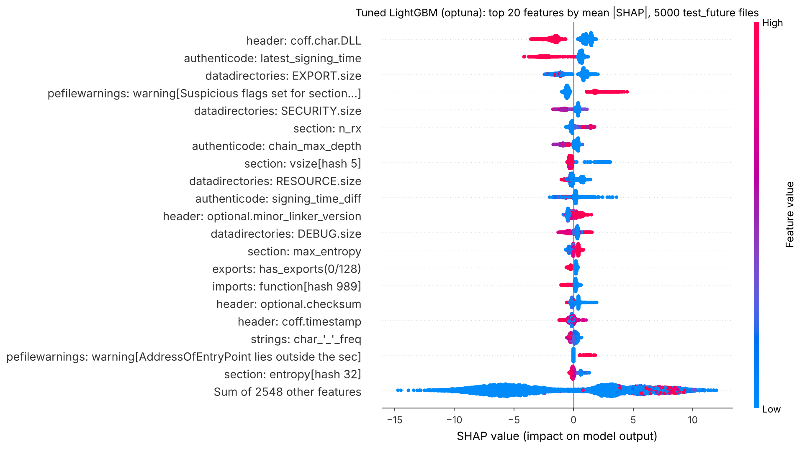
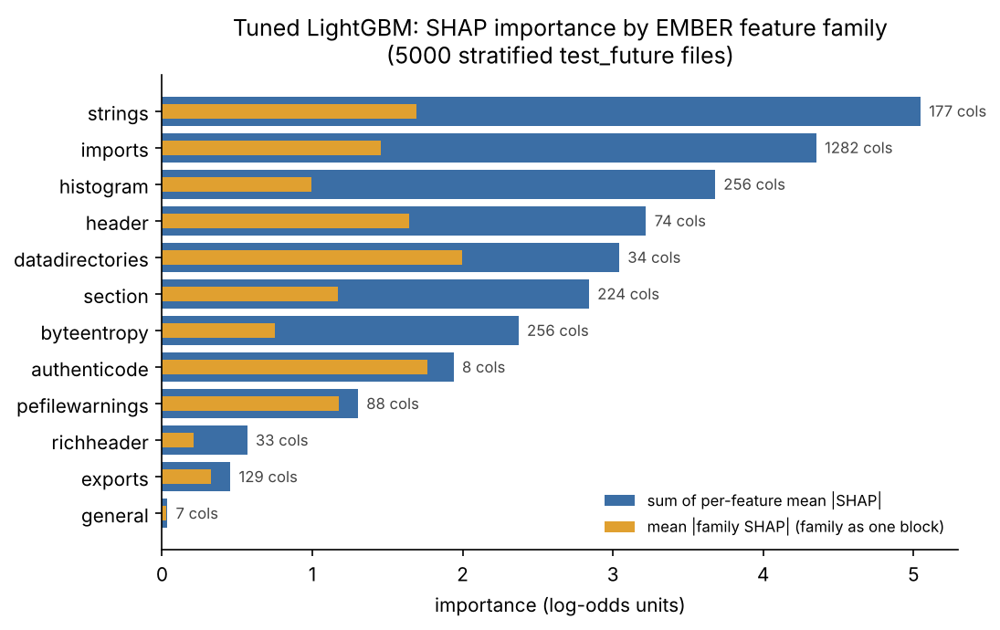
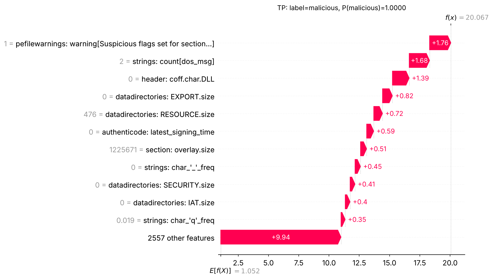
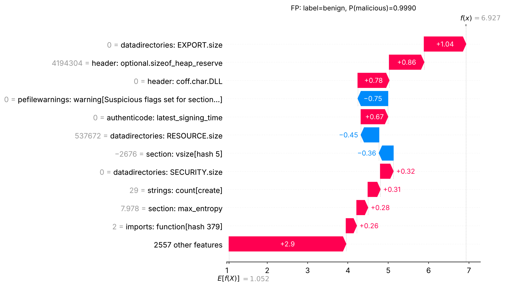
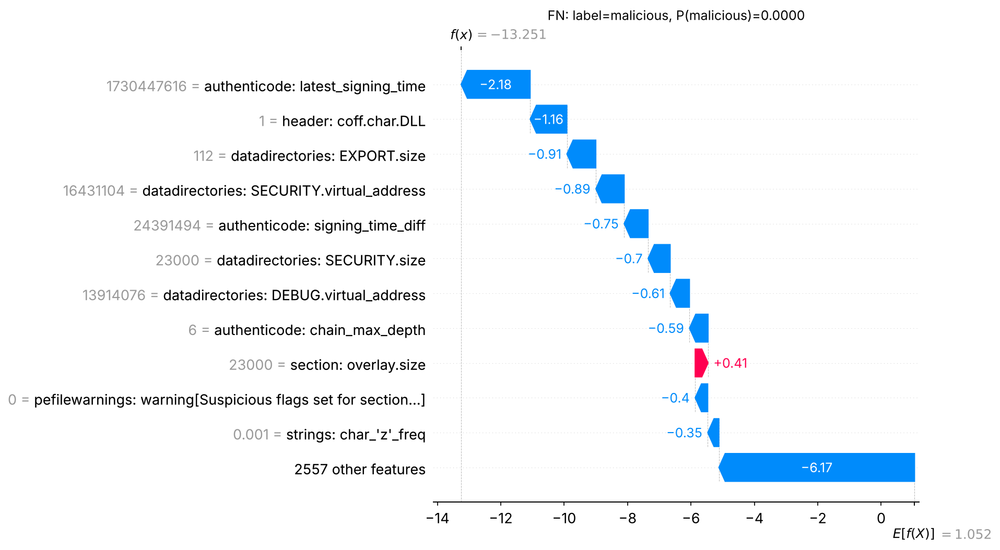
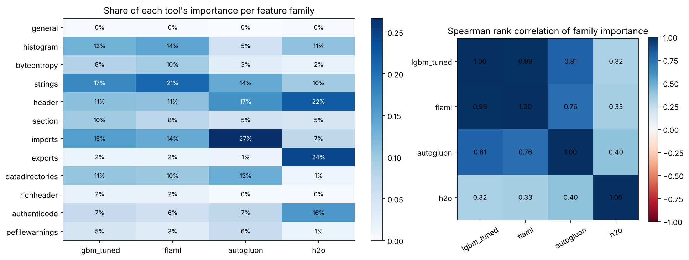
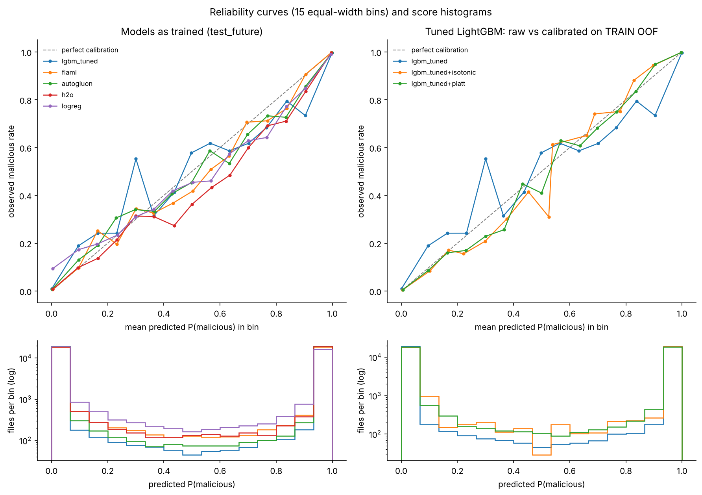
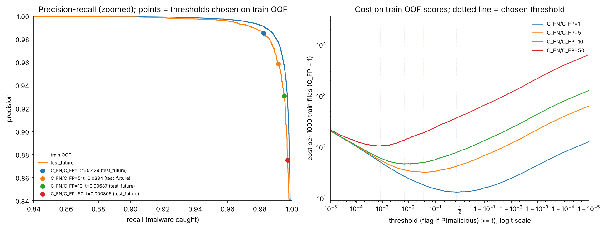

# Explainability, calibration and cost

Step 4 part C. Generated by `scripts/run_explain.py --stages report` from the tables in `reports/tables/` and the saved models and predictions; no number here is typed by hand.

Machine: 4 CPUs, 15.7 GB RAM, Linux-6.18.44-fc-v185-x86_64-with-glibc2.39, with 2 threads (another job shared the machine). Steps 2-3 ran on a 16-core laptop with 63 GB RAM, so the timings below are not comparable with theirs. Train OOF fits took 21.6 min in total; SHAP took 83 s.

## 1. SHAP on the tuned LightGBM

* Model: `models/lgbm_optuna.txt`, the Step 2 tuner with the best CV AUC (`optuna`; chosen on CV, never on a test set).
* Files explained: a label x week stratified sample of 5000 test_future files (2500 malicious, weeks 52-63). Explaining a fixed model is not tuning, so test rows are allowed here; nothing below feeds back into a model.
* Method: TreeSHAP (LightGBM's built-in `pred_contrib`, the same algorithm as `shap.TreeExplainer`; `tests/test_explain.py` checks they agree). Values are in log-odds.
* Checks: the model reproduces the saved test_future scores (max abs difference 4.3e-19); base value + sum of SHAP equals the model's log-odds for every file (max error 4.3e-08).



### Importance by EMBER feature family

Two numbers per family: `sum_mean_abs_shap` adds up each column's mean |SHAP| (comparable with summed gain), `grouped_mean_abs_shap` treats the family as one block (mean of |sum of its SHAP values|), which is smaller when the family's columns push in opposite directions.

| rank | family | n_features | sum_mean_abs_shap | grouped_mean_abs_shap | share | top_feature |
|---|---|---|---|---|---|---|
| 1 | strings | 177 | 5.046 | 1.691 | 17.5% | strings: char_'_'_freq |
| 2 | imports | 1282 | 4.352 | 1.455 | 15.1% | imports: function[hash 989] |
| 3 | histogram | 256 | 3.679 | 0.997 | 12.8% | histogram: byte_0x00_freq |
| 4 | header | 74 | 3.220 | 1.647 | 11.2% | header: coff.char.DLL |
| 5 | datadirectories | 34 | 3.041 | 2.000 | 10.5% | datadirectories: EXPORT.size |
| 6 | section | 224 | 2.840 | 1.168 | 9.8% | section: n_rx |
| 7 | byteentropy | 256 | 2.371 | 0.751 | 8.2% | byteentropy: entropy_bin9/byte_hi_nibble0 |
| 8 | authenticode | 8 | 1.939 | 1.767 | 6.7% | authenticode: latest_signing_time |
| 9 | pefilewarnings | 88 | 1.303 | 1.177 | 4.5% | pefilewarnings: warning[Suspicious flags set for section...] |
| 10 | richheader | 33 | 0.566 | 0.211 | 2.0% | richheader: pair[hash 3] |
| 11 | exports | 129 | 0.454 | 0.324 | 1.6% | exports: has_exports(0/128) |
| 12 | general | 7 | 0.034 | 0.025 | 0.1% | general: size |



The three families with the most total SHAP mass are `strings`, `imports`, `histogram`. Per column, the densest families are `authenticode`, `datadirectories`, `header` (few columns, each one informative). Large families such as `imports` (1,282 hashed columns) collect their mass from many small contributions.

### Top 20 columns

| rank | column | label | mean_abs_shap |
|---|---|---|---|
| 1 | 739 | header: coff.char.DLL | 1.3289 |
| 2 | 2478 | authenticode: latest_signing_time | 1.1208 |
| 3 | 2405 | datadirectories: EXPORT.size | 1.0517 |
| 4 | 2547 | pefilewarnings: warning[Suspicious flags set for section...] | 0.8882 |
| 5 | 2413 | datadirectories: SECURITY.size | 0.4754 |
| 6 | 773 | section: n_rx | 0.4144 |
| 7 | 2477 | authenticode: chain_max_depth | 0.3839 |
| 8 | 836 | section: vsize[hash 5] | 0.3662 |
| 9 | 2409 | datadirectories: RESOURCE.size | 0.3645 |
| 10 | 2479 | authenticode: signing_time_diff | 0.3586 |
| 11 | 706 | header: optional.minor_linker_version | 0.3331 |
| 12 | 2417 | datadirectories: DEBUG.size | 0.3252 |
| 13 | 775 | section: max_entropy | 0.2637 |
| 14 | 2276 | exports: has_exports(0/128) | 0.2591 |
| 15 | 2241 | imports: function[hash 989] | 0.2491 |
| 16 | 724 | header: optional.checksum | 0.2325 |
| 17 | 696 | header: coff.timestamp | 0.2183 |
| 18 | 585 | strings: char_'_'_freq | 0.1978 |
| 19 | 2480 | pefilewarnings: warning[AddressOfEntryPoint lies outside the sec] | 0.1928 |
| 20 | 913 | section: entropy[hash 32] | 0.1906 |

## 2. Do the time proxies rank high?

Three columns already in the feature vector carry time (located in thrember's source; see `src/leakage.py` `TIME_PROXIES`): the COFF header timestamp (column 696) and the two authenticode signing-time columns (2478, 2479). Their rank among all 2,568 columns, per tool (1 = most important; ties share the best rank):

| column | label | rank_lgbm_tuned | rank_flaml | rank_autogluon | rank_h2o |
|---|---|---|---|---|---|
| 696 | header: coff.timestamp | 17 | 32 | 2268 | 40 |
| 2478 | authenticode: latest_signing_time | 2 | 3 | 4 | 3 |
| 2479 | authenticode: signing_time_diff | 10 | 8 | 2557 | 21 |

* `header: coff.timestamp` ranks 17 for the tuned LightGBM (in the top 20).
* `authenticode: latest_signing_time` ranks 2 for the tuned LightGBM (in the top 20).
* `authenticode: signing_time_diff` ranks 10 for the tuned LightGBM (in the top 20).

Whether a proxy acts as a clock or only as a 0 / non-0 flag (unsigned files have signing time 0). `spearman_value_vs_shap_nonzero` is the rank correlation between the column's value and its SHAP value over the files where it is non-zero: far from 0 means the model reads the value itself (a negative sign means larger values push towards benign), near 0 means only the 0 / non-0 split matters.

| label | share_zero_malicious | share_zero_benign | mean_abs_shap_zero_rows | mean_abs_shap_nonzero_rows | spearman_value_vs_shap_nonzero |
|---|---|---|---|---|---|
| header: coff.timestamp | 0.3968 | 0.0236 | 0.1658 | 0.2323 | -0.6009 |
| authenticode: latest_signing_time | 0.9584 | 0.4628 | 0.6276 | 2.3317 | -0.3207 |
| authenticode: signing_time_diff | 0.9588 | 0.4640 | 0.1622 | 0.8426 | -0.3904 |

* `header: coff.timestamp`: 0 for 40% of malicious and 2% of benign files; mean |SHAP| 0.166 where 0 and 0.232 where non-zero; value-vs-SHAP rho -0.60 on the non-zero files.
* `authenticode: latest_signing_time`: 0 for 96% of malicious and 46% of benign files; mean |SHAP| 0.628 where 0 and 2.332 where non-zero; value-vs-SHAP rho -0.32 on the non-zero files.
* `authenticode: signing_time_diff`: 0 for 96% of malicious and 46% of benign files; mean |SHAP| 0.162 where 0 and 0.843 where non-zero; value-vs-SHAP rho -0.39 on the non-zero files.

What this means:

* `authenticode: latest_signing_time` is in the top 5 for every tool: the signature columns are among the strongest signals in this data, whichever tool learns it.
* The signing-time column is mostly a 'signed or not' flag (96% of malicious vs 46% of benign files are unsigned), but on signed files its value matters too (mean |SHAP| 2.33 there; rho -0.32), so the model does partly use it as a clock. That is a time proxy inside X. SHAP shows that the model uses it, not whether it helps or hurts on later files: the ablation that removes these columns and retrains answers that, in the leakage write-up (`reports/leakage.md`).
* AutoGluon's column ranks come from one permutation per column on its validation rows; columns with importance at or below 0 (such as the COFF timestamp there) get arbitrary low ranks, so a rank in the thousands means 'no measurable effect', not 'certainly useless'.

## 3. Three local explanations (waterfall plots)

Picked at threshold 0.5 on the SHAP sample: the most confident correct malicious file (TP), the benign file scored most malicious (FP), and the malicious file scored most benign (FN). Each waterfall starts at the base value (average log-odds) and adds one column's SHAP value per bar. The sentences are generated from the SHAP values; the reading after them is ours.

### TP

TP: a malicious file (sha256 ca22e6563152..., week 52) scored P(malicious) = 1.0000. Largest pushes towards malicious: `pefilewarnings: warning[Suspicious flags set for section...]` = 1 (+1.76); `strings: count[dos_msg]` = 2 (+1.68); `header: coff.char.DLL` = 0 (+1.39); `datadirectories: EXPORT.size` = 0 (+0.82); `datadirectories: RESOURCE.size` = 476 (+0.72). Largest pushes towards benign: none.



Reading: two positive signals lead: pefile flags a section with suspicious permissions, and the file contains the 'This program cannot be run in DOS mode' stub more than once, a typical sign of an embedded second executable (droppers, packers). Absences add to it: not a DLL, no exports, no authenticode signature. Still, the 'other features' bar is the largest: the score is a sum of many small pushes, not one rule.

### FP

FP: a benign file (sha256 ca4d4d5a3b89..., week 62) scored P(malicious) = 0.9990. Largest pushes towards malicious: `datadirectories: EXPORT.size` = 0 (+1.04); `header: optional.sizeof_heap_reserve` = 4.194e+06 (+0.86); `header: coff.char.DLL` = 0 (+0.78); `authenticode: latest_signing_time` = 0 (+0.67). Largest pushes towards benign: `pefilewarnings: warning[Suspicious flags set for section...]` = 0 (-0.75).



Reading: this benign file has the profile the model has learned for malware: an executable (not a DLL) with no exports and no authenticode signature, plus a large heap reserve and a high-entropy section. The absence of the suspicious-section warning pulls the other way but cannot outweigh the rest. Unsigned, unusually built benign software is the classic false positive of static PE detectors.

### FN

FN: a malicious file (sha256 8e6db44a2266..., week 58) scored P(malicious) = 0.0000. Largest pushes towards malicious: none. Largest pushes towards benign: `authenticode: latest_signing_time` = 1.73e+09 (-2.18); `header: coff.char.DLL` = 1 (-1.16); `datadirectories: EXPORT.size` = 112 (-0.91); `datadirectories: SECURITY.virtual_address` = 1.643e+07 (-0.89); `authenticode: signing_time_diff` = 2.439e+07 (-0.75).



Reading: this malware carries the markers the model has learned for benign software: it is an authenticode-signed DLL with exports and a SECURITY directory. The signing-time column is the largest single push. Signed malware (stolen or abused certificates) is exactly what a model that leans on signature presence will miss.

## 4. Do the tools agree on what matters?

Each tool's importance, as it measures it:

* `lgbm_tuned`: mean |TreeSHAP| on 5000 stratified test_future files
* `flaml`: mean |TreeSHAP| of FLAML's tree winner on the same 5000 files
* `autogluon`: permutation importance on AutoGluon's internal validation rows (features: 1 shuffle; families: shuffled as blocks)
* `h2o`: H2O varimp (split gain) of the GBM that carries the stacked ensemble

Per-feature importances are summed into the 12 families (AutoGluon's family number is its own block permutation of each family, which is the more faithful family measure). Top-k overlap = how many of one tool's k most important columns are also in the other's k; Spearman = rank correlation of the 12 family importances (with 12 points, |rho| below about 0.58 is not significant at 5%).

| tool_a | tool_b | top5_overlap | top20_overlap | family_spearman | family_spearman_p | top_family_a | top_family_b |
|---|---|---|---|---|---|---|---|
| lgbm_tuned | flaml | 4 | 14 | 0.99 | 0.000 | strings | strings |
| lgbm_tuned | autogluon | 3 | 8 | 0.81 | 0.001 | strings | imports |
| lgbm_tuned | h2o | 2 | 7 | 0.32 | 0.308 | strings | exports |
| flaml | autogluon | 4 | 8 | 0.76 | 0.004 | strings | imports |
| flaml | h2o | 3 | 10 | 0.33 | 0.297 | strings | exports |
| autogluon | h2o | 3 | 7 | 0.40 | 0.199 | imports | exports |

Most similar pair at family level: `lgbm_tuned` and `flaml` (rho = 0.99); least similar: `lgbm_tuned` and `h2o` (rho = 0.32).



Share of each tool's importance by family:

| family | lgbm_tuned | flaml | autogluon | h2o |
|---|---|---|---|---|
| general | 0.1% | 0.2% | 0.1% | 0.2% |
| histogram | 12.8% | 14.4% | 5.3% | 10.9% |
| byteentropy | 8.2% | 9.6% | 3.1% | 2.0% |
| strings | 17.5% | 21.0% | 13.9% | 9.8% |
| header | 11.2% | 11.0% | 16.7% | 22.2% |
| section | 9.8% | 7.5% | 5.3% | 4.5% |
| imports | 15.1% | 13.6% | 26.7% | 7.3% |
| exports | 1.6% | 1.7% | 1.5% | 24.4% |
| datadirectories | 10.5% | 10.0% | 13.5% | 1.3% |
| richheader | 2.0% | 2.0% | 0.4% | 0.2% |
| authenticode | 6.7% | 5.6% | 7.2% | 15.9% |
| pefilewarnings | 4.5% | 3.3% | 6.4% | 1.4% |

Top 20 columns per tool:

| rank | lgbm_tuned | flaml | autogluon | h2o |
|---|---|---|---|---|
| 1 | header: coff.char.DLL | datadirectories: EXPORT.size | pefilewarnings: warning[Suspicious flags set for section...] | exports: has_exports(0/128) |
| 2 | authenticode: latest_signing_time | header: coff.char.DLL | header: coff.char.DLL | header: coff.char.DLL |
| 3 | datadirectories: EXPORT.size | authenticode: latest_signing_time | datadirectories: DEBUG.size | authenticode: latest_signing_time |
| 4 | pefilewarnings: warning[Suspicious flags set for section...] | pefilewarnings: warning[Suspicious flags set for section...] | authenticode: latest_signing_time | histogram: byte_0x7a_freq |
| 5 | datadirectories: SECURITY.size | exports: has_exports(0/128) | exports: has_exports(0/128) | strings: entropy |
| 6 | section: n_rx | datadirectories: SECURITY.size | header: optional.subsystem | strings: char_'Q'_freq |
| 7 | authenticode: chain_max_depth | header: optional.minor_linker_version | datadirectories: EXPORT.size | strings: char_'Y'_freq |
| 8 | section: vsize[hash 5] | authenticode: signing_time_diff | header: optional.dll_char.GUARD_CF | pefilewarnings: warning[Suspicious flags set for section...] |
| 9 | datadirectories: RESOURCE.size | datadirectories: RESOURCE.size | datadirectories: SECURITY.size | section: overlay.entropy |
| 10 | authenticode: signing_time_diff | datadirectories: DEBUG.size | authenticode: empty_program_name | header: optional.dll_char.TERMINAL_SERVER_AWARE |
| 11 | header: optional.minor_linker_version | strings: entropy | header: optional.dll_char.TERMINAL_SERVER_AWARE | authenticode: chain_max_depth |
| 12 | datadirectories: DEBUG.size | header: optional.subsystem | header: optional.sizeof_stack_reserve | header: optional.dll_char.GUARD_CF |
| 13 | section: max_entropy | strings: char_'_'_freq | section: vsize[hash 5] | datadirectories: DEBUG.size |
| 14 | exports: has_exports(0/128) | header: optional.checksum | section: size[hash 5] | strings: char_'q'_freq |
| 15 | imports: function[hash 989] | imports: n_imported_functions | histogram: byte_0x5f_freq | header: optional.minor_linker_version |
| 16 | header: optional.checksum | imports: function[hash 989] | imports: library[hash 30] | section: size[hash 19] |
| 17 | header: coff.timestamp | section: max_entropy | datadirectories: has_relocs | imports: function[hash 215] |
| 18 | strings: char_'_'_freq | strings: char_'Q'_freq | strings: count[process] | imports: function[hash 170] |
| 19 | pefilewarnings: warning[AddressOfEntryPoint lies outside the sec] | strings: char_'q'_freq | header: optional.sizeof_uninitialized_data | exports: export[hash 44] |
| 20 | section: entropy[hash 32] | histogram: byte_0x7a_freq | authenticode: self_signed | imports: function[hash 319] |

Caveats: the measures differ (SHAP on test_future files; split gain on train; permutation on AutoGluon's validation rows), and AutoGluon's per-column permutation used one shuffle per column, so its column ranks are noisy; its family ranks used several shuffles. Gain-based varimp piles credit onto the first strong split (H2O), so a family can dominate gain while SHAP spreads credit more evenly. Agreement at family level with disagreement on single hashed columns is expected: correlated or near-duplicate columns can substitute for each other.

## 5. Calibration (test_future)

Brier score = mean squared error of the probability (lower is better); ECE = weighted mean gap between score and observed malicious rate over 15 equal-width bins. The CI columns are 95% paired-bootstrap intervals (1000 resamples); `brier_diff_*` is the CI of (model - tuned LightGBM), so an interval that excludes 0 is a real difference. Isotonic and Platt calibrators were fitted on the TRAIN out-of-fold scores (section 6), never on a test set, and then applied to the tuned model's test_future scores.

| model | test_set | brier | brier_ci_low | brier_ci_high | brier_diff_ci_low | brier_diff_ci_high | log_loss | ece | roc_auc |
|---|---|---|---|---|---|---|---|---|---|
| lgbm_tuned | test_future | 0.0132 | 0.0123 | 0.0142 |  |  | 0.0587 | 0.0085 | 0.9981 |
| flaml | test_future | 0.0160 | 0.0150 | 0.0169 | 0.0022 | 0.0032 | 0.0576 | 0.0041 | 0.9976 |
| autogluon | test_future | 0.0129 | 0.0121 | 0.0138 | -0.0006 | 0.0000 | 0.0522 | 0.0056 | 0.9980 |
| h2o | test_future | 0.0173 | 0.0164 | 0.0183 | 0.0035 | 0.0047 | 0.0635 | 0.0062 | 0.9970 |
| logreg | test_future | 0.0700 | 0.0677 | 0.0721 | 0.0545 | 0.0590 | 0.6227 | 0.0513 | 0.9297 |
| lgbm_tuned+isotonic | test_future | 0.0129 | 0.0121 | 0.0137 | -0.0006 | -0.0001 | 0.0484 | 0.0037 | 0.9981 |
| lgbm_tuned+platt | test_future | 0.0129 | 0.0120 | 0.0137 | -0.0006 | -0.0002 | 0.0485 | 0.0030 | 0.9981 |
| lgbm_tuned (train OOF) | train_oof | 0.0109 |  |  |  |  | 0.0502 | 0.0080 | 0.9988 |



* Lowest Brier score among the uncalibrated models: `autogluon`. The tuned LightGBM scores 0.0132 with ECE 0.0085.
* `lgbm_tuned+isotonic`: Brier 0.0129 (difference CI -0.0006 to -0.0001: a real improvement).
* `lgbm_tuned+platt`: Brier 0.0129 (difference CI -0.0006 to -0.0002: a real improvement).
* Almost every file scores near 0 or 1 (bottom panels), so the middle of each reliability curve rests on few files and zig-zags; read the Brier and ECE numbers, not the wiggles.
* The calibrators learn from fold models trained on two thirds of train, while the deployed model is trained on all of it and is slightly more confident; and test_future is later in time than train. Both limit how well a train-fitted calibrator transfers.

## 6. Cost-sensitive threshold

A missed malware file (FN) is taken to cost C_FN = 10 false alarms (C_FP = 1). The threshold minimising C_FN*FN + C_FP*FP is found exactly (every distinct score is tried) on the TRAIN out-of-fold scores: 160000 files, each scored by a model fitted on the other two folds (persisted 3-fold CV of train, tuned params, 609 rounds). No test set is used to choose it; test_future only reports how the choice holds up later in time.

| cost_ratio | threshold | oof_fn | oof_fp | oof_cost_per_1000 | test_future_precision | test_future_recall | test_future_fpr | test_future_fn | test_future_fp | test_future_cost_per_1000 | test_future_cost_per_1000_at_0.5 |
|---|---|---|---|---|---|---|---|---|---|---|---|
| 1 | 0.429 | 1165 | 944 | 13.18 | 0.9852 | 0.9824 | 0.0148 | 353 | 295 | 16.20 | 16.12 |
| 5 | 0.0384 | 563 | 2343 | 32.24 | 0.9583 | 0.9916 | 0.0431 | 169 | 862 | 42.67 | 54.23 |
| 10 | 0.006865 | 355 | 3946 | 46.85 | 0.9305 | 0.9951 | 0.0743 | 99 | 1486 | 61.90 | 101.85 |
| 50 | 0.0008052 | 173 | 8093 | 104.64 | 0.8751 | 0.9973 | 0.1424 | 55 | 2847 | 139.93 | 482.85 |



* Deployed choice (`models/threshold.json`): threshold 0.006865 at C_FN/C_FP = 10. On test_future it gives precision 0.9305, recall 0.9951 and FPR 0.0743, a cost of 61.90 per 1000 files against 101.85 at the default 0.5 (lower).
* Later in time the same cut flags more benign files: FPR 0.0493 on train OOF vs 0.0743 on test_future, recall 0.9956 vs 0.9951. The cut sits deep in the tail of the score distribution, where drift in benign software shows up first.
* Ratios where the OOF-chosen cut did NOT beat the default 0.5 on test_future: 1.
* A higher miss cost moves the threshold down (more files flagged, fewer misses, more false alarms).
* The OOF scores come from fold models fitted on two thirds of train; the deployed model is fitted on all of train and may be slightly more confident, which matters most for a cut this far into the tail.
* The classes are 50/50 by construction. In real traffic malware is rarer, so the same threshold gives more false alarms per detection; the threshold should be re-derived for the deployment's prevalence and real costs.

## Reproduce

```bash
.venv/bin/python scripts/run_explain.py --stages oof        # long: run detached, writes a log
.venv/bin/python scripts/run_explain.py --stages shap,agreement,calibration,threshold,report
```
