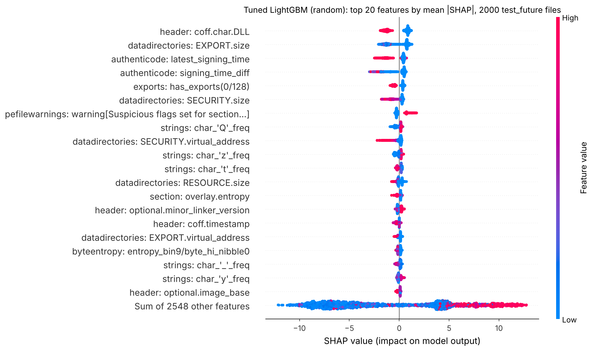
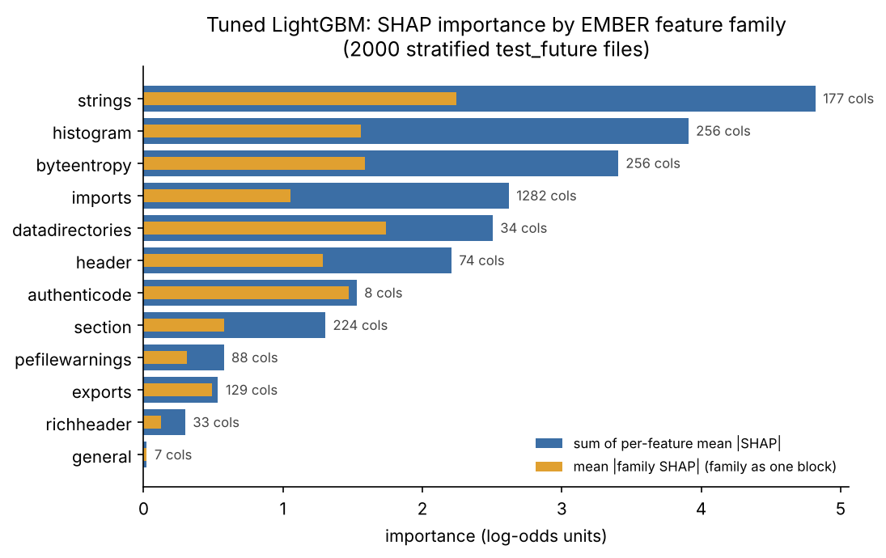
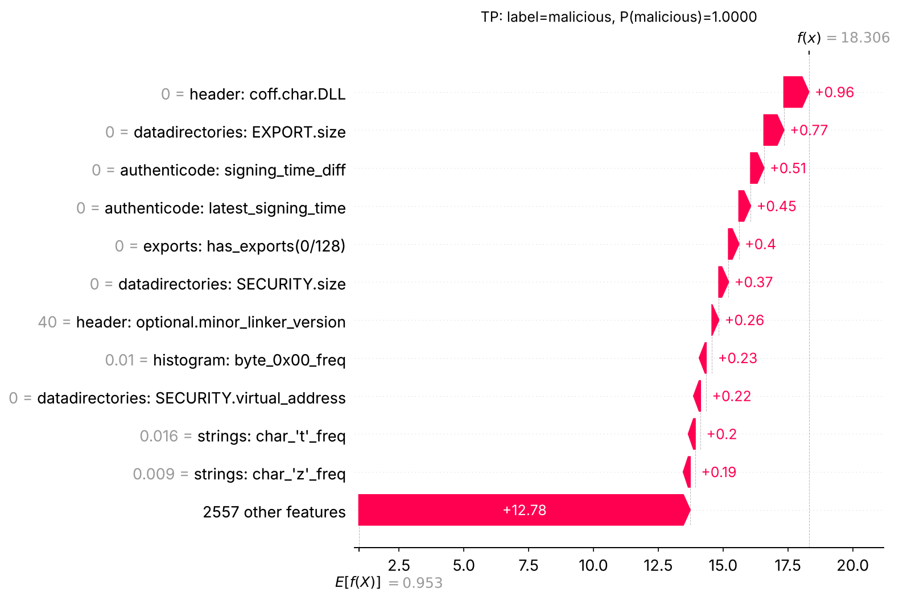
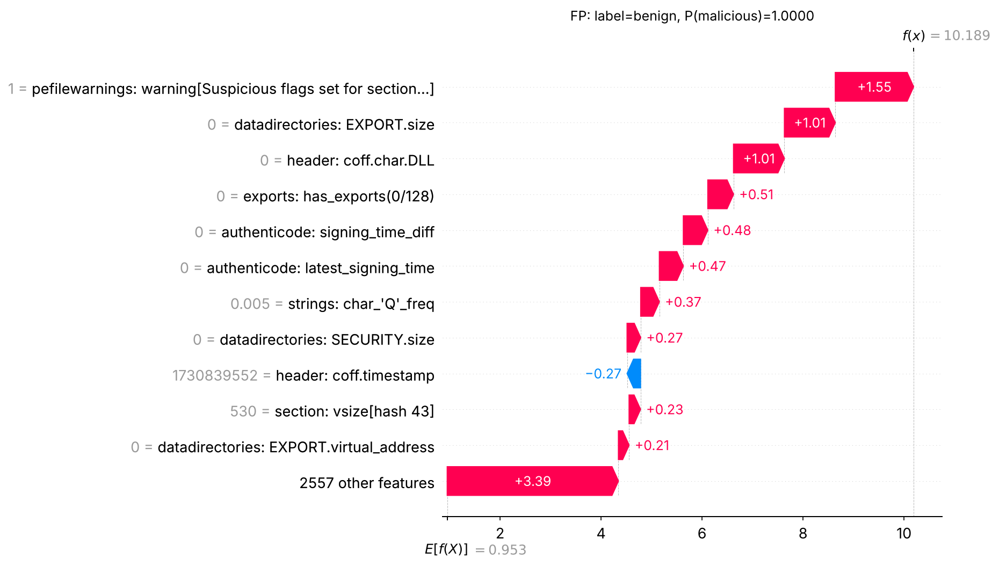
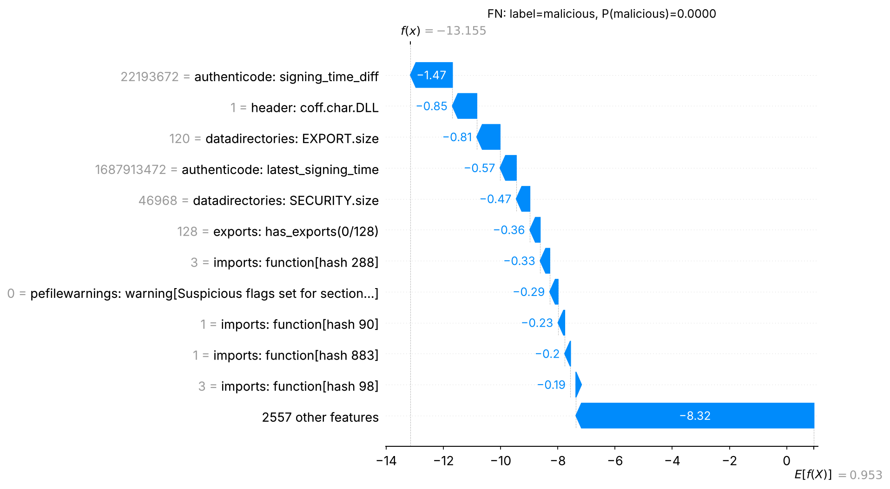
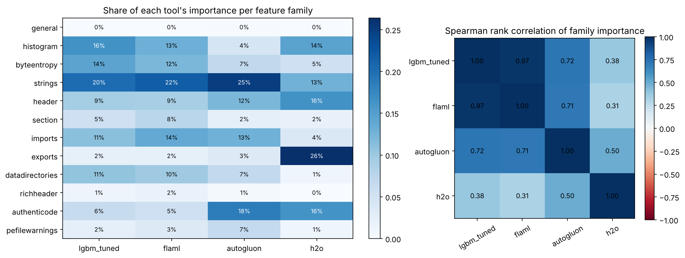
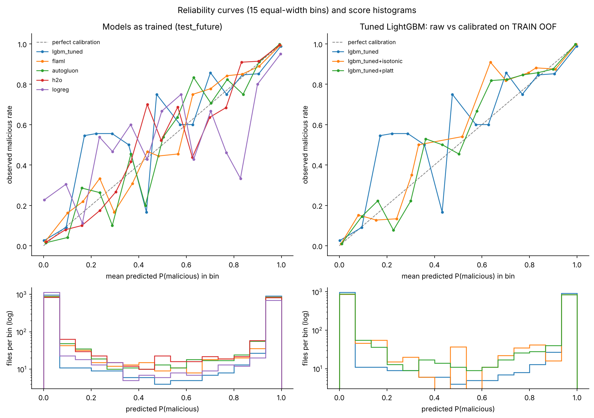
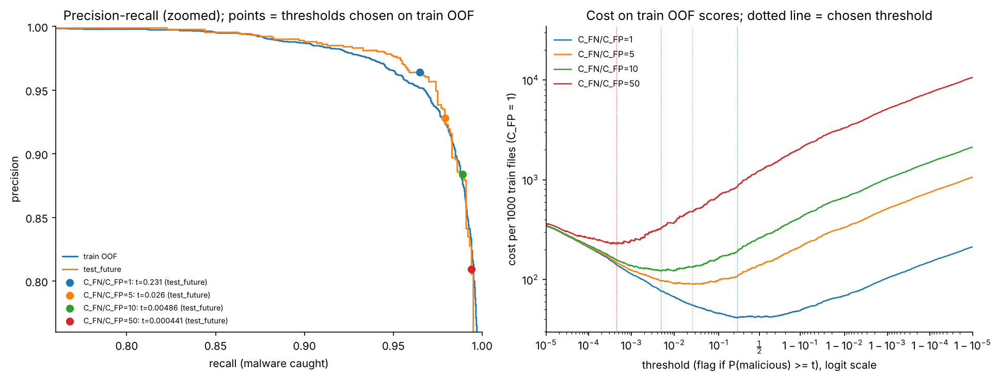

# Explainability, calibration and cost (QUICK smoke run: tiny samples, not results)

Step 4 part C. Generated by `scripts/run_explain.py --stages report` from the tables in `reports/tables/` and the saved models and predictions; no number here is typed by hand.

Machine: 4 CPUs, 15.7 GB RAM, Linux-6.18.44-fc-v185-x86_64-with-glibc2.39, with 2 threads (another job shared the machine). Steps 2-3 ran on a 16-core laptop with 63 GB RAM, so the timings below are not comparable with theirs. Train OOF fits took 1.2 min in total; SHAP took 18 s.

## 1. SHAP on the tuned LightGBM

* Model: `models/lgbm_random_quick.txt`, the Step 2 tuner with the best CV AUC (`random`; chosen on CV, never on a test set).
* Files explained: a label x week stratified sample of 2000 test_future files (999 malicious, weeks 52-63). Explaining a fixed model is not tuning, so test rows are allowed here; nothing below feeds back into a model.
* Method: TreeSHAP (LightGBM's built-in `pred_contrib`, the same algorithm as `shap.TreeExplainer`; `tests/test_explain.py` checks they agree). Values are in log-odds.
* Checks: the model reproduces the saved test_future scores (max abs difference 2.2e-19); base value + sum of SHAP equals the model's log-odds for every file (max error 9.8e-09).



### Importance by EMBER feature family

Two numbers per family: `sum_mean_abs_shap` adds up each column's mean |SHAP| (comparable with summed gain), `grouped_mean_abs_shap` treats the family as one block (mean of |sum of its SHAP values|), which is smaller when the family's columns push in opposite directions.

| rank | family | n_features | sum_mean_abs_shap | grouped_mean_abs_shap | share | top_feature |
|---|---|---|---|---|---|---|
| 1 | strings | 177 | 4.820 | 2.245 | 20.3% | strings: char_'Q'_freq |
| 2 | histogram | 256 | 3.908 | 1.561 | 16.5% | histogram: byte_0x00_freq |
| 3 | byteentropy | 256 | 3.404 | 1.585 | 14.3% | byteentropy: entropy_bin9/byte_hi_nibble0 |
| 4 | imports | 1282 | 2.620 | 1.054 | 11.0% | imports: n_imported_functions |
| 5 | datadirectories | 34 | 2.504 | 1.738 | 10.6% | datadirectories: EXPORT.size |
| 6 | header | 74 | 2.209 | 1.289 | 9.3% | header: coff.char.DLL |
| 7 | authenticode | 8 | 1.529 | 1.469 | 6.4% | authenticode: latest_signing_time |
| 8 | section | 224 | 1.304 | 0.578 | 5.5% | section: overlay.entropy |
| 9 | pefilewarnings | 88 | 0.575 | 0.313 | 2.4% | pefilewarnings: warning[Suspicious flags set for section...] |
| 10 | exports | 129 | 0.534 | 0.489 | 2.3% | exports: has_exports(0/128) |
| 11 | richheader | 33 | 0.299 | 0.124 | 1.3% | richheader: pair[hash 3] |
| 12 | general | 7 | 0.023 | 0.020 | 0.1% | general: size |



The three families with the most total SHAP mass are `strings`, `histogram`, `byteentropy`. Per column, the densest families are `authenticode`, `datadirectories`, `header` (few columns, each one informative). Large families such as `imports` (1,282 hashed columns) collect their mass from many small contributions.

### Top 20 columns

| rank | column | label | mean_abs_shap |
|---|---|---|---|
| 1 | 739 | header: coff.char.DLL | 1.0347 |
| 2 | 2405 | datadirectories: EXPORT.size | 0.9643 |
| 3 | 2478 | authenticode: latest_signing_time | 0.6851 |
| 4 | 2479 | authenticode: signing_time_diff | 0.6837 |
| 5 | 2276 | exports: has_exports(0/128) | 0.4446 |
| 6 | 2413 | datadirectories: SECURITY.size | 0.4340 |
| 7 | 2547 | pefilewarnings: warning[Suspicious flags set for section...] | 0.3964 |
| 8 | 571 | strings: char_'Q'_freq | 0.2449 |
| 9 | 2414 | datadirectories: SECURITY.virtual_address | 0.2058 |
| 10 | 612 | strings: char_'z'_freq | 0.1970 |
| 11 | 606 | strings: char_'t'_freq | 0.1949 |
| 12 | 2409 | datadirectories: RESOURCE.size | 0.1902 |
| 13 | 993 | section: overlay.entropy | 0.1758 |
| 14 | 706 | header: optional.minor_linker_version | 0.1601 |
| 15 | 696 | header: coff.timestamp | 0.1530 |
| 16 | 2406 | datadirectories: EXPORT.virtual_address | 0.1422 |
| 17 | 407 | byteentropy: entropy_bin9/byte_hi_nibble0 | 0.1408 |
| 18 | 585 | strings: char_'_'_freq | 0.1357 |
| 19 | 611 | strings: char_'y'_freq | 0.1341 |
| 20 | 722 | header: optional.image_base | 0.1336 |

## 2. Do the time proxies rank high?

Three columns already in the feature vector carry time (located in thrember's source; see `src/leakage.py` `TIME_PROXIES`): the COFF header timestamp (column 696) and the two authenticode signing-time columns (2478, 2479). Their rank among all 2,568 columns, per tool (1 = most important; ties share the best rank):

| column | label | rank_lgbm_tuned | rank_flaml | rank_autogluon | rank_h2o |
|---|---|---|---|---|---|
| 696 | header: coff.timestamp | 15 | 46 | 26 | 259 |
| 2478 | authenticode: latest_signing_time | 3 | 5 | 486 | 3 |
| 2479 | authenticode: signing_time_diff | 4 | 3 | 486 | 176 |

* `header: coff.timestamp` ranks 15 for the tuned LightGBM (in the top 20).
* `authenticode: latest_signing_time` ranks 3 for the tuned LightGBM (in the top 20).
* `authenticode: signing_time_diff` ranks 4 for the tuned LightGBM (in the top 20).

Whether a proxy acts as a clock or only as a 0 / non-0 flag (unsigned files have signing time 0). `spearman_value_vs_shap_nonzero` is the rank correlation between the column's value and its SHAP value over the files where it is non-zero: far from 0 means the model reads the value itself (a negative sign means larger values push towards benign), near 0 means only the 0 / non-0 split matters.

| label | share_zero_malicious | share_zero_benign | mean_abs_shap_zero_rows | mean_abs_shap_nonzero_rows | spearman_value_vs_shap_nonzero |
|---|---|---|---|---|---|
| header: coff.timestamp | 0.3724 | 0.0350 | 0.0184 | 0.1874 | -0.7094 |
| authenticode: latest_signing_time | 0.9650 | 0.4825 | 0.4204 | 1.3776 | -0.2983 |
| authenticode: signing_time_diff | 0.9650 | 0.4865 | 0.4440 | 1.3171 | -0.8783 |

* `header: coff.timestamp`: 0 for 37% of malicious and 3% of benign files; mean |SHAP| 0.018 where 0 and 0.187 where non-zero; value-vs-SHAP rho -0.71 on the non-zero files.
* `authenticode: latest_signing_time`: 0 for 96% of malicious and 48% of benign files; mean |SHAP| 0.420 where 0 and 1.378 where non-zero; value-vs-SHAP rho -0.30 on the non-zero files.
* `authenticode: signing_time_diff`: 0 for 96% of malicious and 49% of benign files; mean |SHAP| 0.444 where 0 and 1.317 where non-zero; value-vs-SHAP rho -0.88 on the non-zero files.

What this means:

* The signing-time column is mostly a 'signed or not' flag (96% of malicious vs 48% of benign files are unsigned), but on signed files its value matters too (mean |SHAP| 1.38 there; rho -0.30), so the model does partly use it as a clock. That is a time proxy inside X. SHAP shows that the model uses it, not whether it helps or hurts on later files: the ablation that removes these columns and retrains answers that, in the leakage write-up (`reports/leakage.md`).
* AutoGluon's column ranks come from one permutation per column on its validation rows; columns with importance at or below 0 (such as the COFF timestamp there) get arbitrary low ranks, so a rank in the thousands means 'no measurable effect', not 'certainly useless'.

## 3. Three local explanations (waterfall plots)

Picked at threshold 0.5 on the SHAP sample: the most confident correct malicious file (TP), the benign file scored most malicious (FP), and the malicious file scored most benign (FN). Each waterfall starts at the base value (average log-odds) and adds one column's SHAP value per bar. The sentences are generated from the SHAP values; the reading after them is ours.

### TP

TP: a malicious file (sha256 37de7aeda609..., week 57) scored P(malicious) = 1.0000. Largest pushes towards malicious: `header: coff.char.DLL` = 0 (+0.96); `datadirectories: EXPORT.size` = 0 (+0.77); `authenticode: signing_time_diff` = 0 (+0.51); `authenticode: latest_signing_time` = 0 (+0.45); `exports: has_exports(0/128)` = 0 (+0.40). Largest pushes towards benign: none.



(The hand-written reading is for the full run only.)

### FP

FP: a benign file (sha256 0016a9a88cfb..., week 58) scored P(malicious) = 1.0000. Largest pushes towards malicious: `pefilewarnings: warning[Suspicious flags set for section...]` = 1 (+1.55); `datadirectories: EXPORT.size` = 0 (+1.01); `header: coff.char.DLL` = 0 (+1.01); `exports: has_exports(0/128)` = 0 (+0.51); `authenticode: signing_time_diff` = 0 (+0.48). Largest pushes towards benign: none.



(The hand-written reading is for the full run only.)

### FN

FN: a malicious file (sha256 182e1a9f20b7..., week 57) scored P(malicious) = 0.0000. Largest pushes towards malicious: none. Largest pushes towards benign: `authenticode: signing_time_diff` = 2.219e+07 (-1.47); `header: coff.char.DLL` = 1 (-0.85); `datadirectories: EXPORT.size` = 120 (-0.81); `authenticode: latest_signing_time` = 1.688e+09 (-0.57); `datadirectories: SECURITY.size` = 4.697e+04 (-0.47).



(The hand-written reading is for the full run only.)

## 4. Do the tools agree on what matters?

Each tool's importance, as it measures it:

* `lgbm_tuned`: mean |TreeSHAP| on 2000 stratified test_future files
* `flaml`: mean |TreeSHAP| of FLAML's tree winner on the same 2000 files
* `autogluon`: permutation importance on AutoGluon's internal validation rows (features: 1 shuffle; families: shuffled as blocks)
* `h2o`: H2O varimp (split gain) of the GBM that carries the stacked ensemble

Per-feature importances are summed into the 12 families (AutoGluon's family number is its own block permutation of each family, which is the more faithful family measure). Top-k overlap = how many of one tool's k most important columns are also in the other's k; Spearman = rank correlation of the 12 family importances (with 12 points, |rho| below about 0.58 is not significant at 5%).

| tool_a | tool_b | top5_overlap | top20_overlap | family_spearman | family_spearman_p | top_family_a | top_family_b |
|---|---|---|---|---|---|---|---|
| lgbm_tuned | flaml | 4 | 15 | 0.97 | 0.000 | strings | strings |
| lgbm_tuned | autogluon | 1 | 5 | 0.72 | 0.008 | strings | strings |
| lgbm_tuned | h2o | 3 | 7 | 0.38 | 0.226 | strings | exports |
| flaml | autogluon | 1 | 4 | 0.71 | 0.009 | strings | strings |
| flaml | h2o | 2 | 7 | 0.31 | 0.319 | strings | exports |
| autogluon | h2o | 1 | 3 | 0.50 | 0.101 | strings | exports |

Most similar pair at family level: `lgbm_tuned` and `flaml` (rho = 0.97); least similar: `flaml` and `h2o` (rho = 0.31).



Share of each tool's importance by family:

| family | lgbm_tuned | flaml | autogluon | h2o |
|---|---|---|---|---|
| general | 0.1% | 0.0% | 0.2% | 0.0% |
| histogram | 16.5% | 13.1% | 4.3% | 14.4% |
| byteentropy | 14.3% | 12.2% | 7.0% | 5.5% |
| strings | 20.3% | 21.7% | 24.9% | 12.8% |
| header | 9.3% | 9.2% | 12.1% | 16.5% |
| section | 5.5% | 7.5% | 2.4% | 2.0% |
| imports | 11.0% | 13.8% | 12.9% | 3.8% |
| exports | 2.3% | 2.2% | 3.4% | 26.4% |
| datadirectories | 10.6% | 9.8% | 6.9% | 1.1% |
| richheader | 1.3% | 1.8% | 0.5% | 0.0% |
| authenticode | 6.4% | 5.4% | 18.5% | 16.4% |
| pefilewarnings | 2.4% | 3.4% | 6.8% | 1.1% |

Top 20 columns per tool:

| rank | lgbm_tuned | flaml | autogluon | h2o |
|---|---|---|---|---|
| 1 | header: coff.char.DLL | header: coff.char.DLL | header: coff.char.DLL | exports: has_exports(0/128) |
| 2 | datadirectories: EXPORT.size | datadirectories: EXPORT.size | header: optional.minor_linker_version | header: coff.char.DLL |
| 3 | authenticode: latest_signing_time | authenticode: signing_time_diff | section: vsize[hash 43] | authenticode: latest_signing_time |
| 4 | authenticode: signing_time_diff | pefilewarnings: warning[Suspicious flags set for section...] | imports: library[hash 170] | histogram: byte_0x7a_freq |
| 5 | exports: has_exports(0/128) | authenticode: latest_signing_time | strings: char_'Q'_freq | strings: char_'J'_freq |
| 6 | datadirectories: SECURITY.size | strings: char_'Q'_freq | strings: count[dos_msg] | byteentropy: entropy_bin9/byte_hi_nibble0 |
| 7 | pefilewarnings: warning[Suspicious flags set for section...] | strings: char_'t'_freq | section: overlay.entropy | authenticode: chain_max_depth |
| 8 | strings: char_'Q'_freq | datadirectories: SECURITY.size | header: optional.sizeof_image | strings: char_'K'_freq |
| 9 | datadirectories: SECURITY.virtual_address | exports: has_exports(0/128) | header: optional.checksum | strings: char_'z'_freq |
| 10 | strings: char_'z'_freq | byteentropy: entropy_bin9/byte_hi_nibble0 | header: optional.sizeof_stack_reserve | pefilewarnings: warning[Suspicious flags set for section...] |
| 11 | strings: char_'t'_freq | datadirectories: BASERELOC.virtual_address | histogram: byte_0x43_freq | strings: entropy |
| 12 | datadirectories: RESOURCE.size | strings: char_'z'_freq | strings: count[snapshot] | strings: char_'q'_freq |
| 13 | section: overlay.entropy | section: overlay.size | imports: library[hash 93] | authenticode: num_certs |
| 14 | header: optional.minor_linker_version | header: optional.minor_linker_version | byteentropy: entropy_bin6/byte_hi_nibble2 | section: entropy[hash 32] |
| 15 | header: coff.timestamp | imports: function[hash 98] | imports: library[hash 201] | strings: char_'Y'_freq |
| 16 | datadirectories: EXPORT.virtual_address | byteentropy: entropy_bin6/byte_hi_nibble14 | strings: char_':'_freq | datadirectories: DEBUG.size |
| 17 | byteentropy: entropy_bin9/byte_hi_nibble0 | strings: char_'_'_freq | strings: char_'e'_freq | histogram: byte_0xca_freq |
| 18 | strings: char_'_'_freq | byteentropy: entropy_bin6/byte_hi_nibble12 | header: optional.dll_char.DYNAMIC_BASE | strings: char_'e'_freq |
| 19 | strings: char_'y'_freq | datadirectories: RESOURCE.size | strings: char_'_'_freq | strings: char_'Q'_freq |
| 20 | header: optional.image_base | strings: char_'y'_freq | imports: n_imported_functions | strings: char_"'"_freq |

Caveats: the measures differ (SHAP on test_future files; split gain on train; permutation on AutoGluon's validation rows), and AutoGluon's per-column permutation used one shuffle per column, so its column ranks are noisy; its family ranks used several shuffles. Gain-based varimp piles credit onto the first strong split (H2O), so a family can dominate gain while SHAP spreads credit more evenly. Agreement at family level with disagreement on single hashed columns is expected: correlated or near-duplicate columns can substitute for each other.

## 5. Calibration (test_future)

Brier score = mean squared error of the probability (lower is better); ECE = weighted mean gap between score and observed malicious rate over 15 equal-width bins. The CI columns are 95% paired-bootstrap intervals (1000 resamples); `brier_diff_*` is the CI of (model - tuned LightGBM), so an interval that excludes 0 is a real difference. Isotonic and Platt calibrators were fitted on the TRAIN out-of-fold scores (section 6), never on a test set, and then applied to the tuned model's test_future scores.

| model | test_set | brier | brier_ci_low | brier_ci_high | brier_diff_ci_low | brier_diff_ci_high | log_loss | ece | roc_auc |
|---|---|---|---|---|---|---|---|---|---|
| lgbm_tuned | test_future | 0.0299 | 0.0239 | 0.0365 |  |  | 0.1388 | 0.0236 | 0.9924 |
| flaml | test_future | 0.0326 | 0.0267 | 0.0390 | -0.0005 | 0.0058 | 0.1250 | 0.0144 | 0.9895 |
| autogluon | test_future | 0.0291 | 0.0238 | 0.0348 | -0.0030 | 0.0015 | 0.1055 | 0.0152 | 0.9923 |
| h2o | test_future | 0.0349 | 0.0294 | 0.0410 | 0.0019 | 0.0082 | 0.1243 | 0.0130 | 0.9892 |
| logreg | test_future | 0.1662 | 0.1513 | 0.1823 | 0.1214 | 0.1523 | 2.1020 | 0.1593 | 0.7599 |
| lgbm_tuned+isotonic | test_future | 0.0283 | 0.0234 | 0.0335 | -0.0035 | -0.0000 | 0.1021 | 0.0121 | 0.9926 |
| lgbm_tuned+platt | test_future | 0.0280 | 0.0231 | 0.0331 | -0.0034 | -0.0004 | 0.1026 | 0.0126 | 0.9924 |
| lgbm_tuned (train OOF) | train_oof | 0.0336 |  |  |  |  | 0.1453 | 0.0259 | 0.9924 |



* Lowest Brier score among the uncalibrated models: `autogluon`. The tuned LightGBM scores 0.0299 with ECE 0.0236.
* `lgbm_tuned+isotonic`: Brier 0.0283 (difference CI -0.0035 to -0.0000: a real improvement).
* `lgbm_tuned+platt`: Brier 0.0280 (difference CI -0.0034 to -0.0004: a real improvement).
* Almost every file scores near 0 or 1 (bottom panels), so the middle of each reliability curve rests on few files and zig-zags; read the Brier and ECE numbers, not the wiggles.
* The calibrators learn from fold models trained on two thirds of train, while the deployed model is trained on all of it and is slightly more confident; and test_future is later in time than train. Both limit how well a train-fitted calibrator transfers.

## 6. Cost-sensitive threshold

A missed malware file (FN) is taken to cost C_FN = 10 false alarms (C_FP = 1). The threshold minimising C_FN*FN + C_FP*FP is found exactly (every distinct score is tried) on the TRAIN out-of-fold scores: 8000 files, each scored by a model fitted on the other two folds (persisted 3-fold CV of train, tuned params, 479 rounds). No test set is used to choose it; test_future only reports how the choice holds up later in time.

| cost_ratio | threshold | oof_fn | oof_fp | oof_cost_per_1000 | test_future_precision | test_future_recall | test_future_fpr | test_future_fn | test_future_fp | test_future_cost_per_1000 | test_future_cost_per_1000_at_0.5 |
|---|---|---|---|---|---|---|---|---|---|---|---|
| 1 | 0.2307 | 131 | 198 | 41.12 | 0.9640 | 0.9650 | 0.0360 | 35 | 36 | 35.50 | 36.00 |
| 5 | 0.02601 | 69 | 373 | 89.75 | 0.9279 | 0.9790 | 0.0759 | 21 | 76 | 90.50 | 134.00 |
| 10 | 0.004855 | 40 | 575 | 121.88 | 0.8837 | 0.9890 | 0.1299 | 11 | 130 | 120.00 | 256.50 |
| 50 | 0.0004407 | 14 | 1116 | 227.00 | 0.8093 | 0.9940 | 0.2338 | 6 | 234 | 267.00 | 1236.50 |



* Deployed choice (`models/threshold_quick.json`): threshold 0.004855 at C_FN/C_FP = 10. On test_future it gives precision 0.8837, recall 0.9890 and FPR 0.1299, a cost of 120.00 per 1000 files against 256.50 at the default 0.5 (lower).
* Later in time the same cut flags more benign files: FPR 0.1437 on train OOF vs 0.1299 on test_future, recall 0.9900 vs 0.9890. The cut sits deep in the tail of the score distribution, where drift in benign software shows up first.
* Ratios where the OOF-chosen cut did NOT beat the default 0.5 on test_future: none.
* A higher miss cost moves the threshold down (more files flagged, fewer misses, more false alarms).
* The OOF scores come from fold models fitted on two thirds of train; the deployed model is fitted on all of train and may be slightly more confident, which matters most for a cut this far into the tail.
* The classes are 50/50 by construction. In real traffic malware is rarer, so the same threshold gives more false alarms per detection; the threshold should be re-derived for the deployment's prevalence and real costs.

## Reproduce

```bash
.venv/bin/python scripts/run_explain.py --stages oof        # long: run detached, writes a log
.venv/bin/python scripts/run_explain.py --stages shap,agreement,calibration,threshold,report
```
