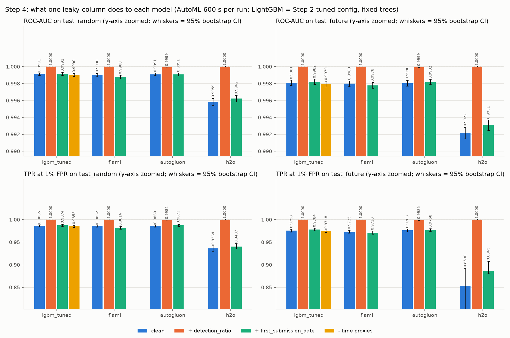

# Step 4A: leakage experiments

Generated by `scripts/run_leakage.py` (`src/leakage_writeup.py`) from `reports/experiments.jsonl` (records with step `leakage`), the saved test scores and run logs. Table: `reports/tables/leakage.csv`. Figure: `reports/figures/leakage_jump.png`. Do not edit by hand.

## What was run

| Variant | Change to the 2,568 standard features |
|---|---|
| `clean` | none (the inputs of Steps 2 and 3) |
| `leak_detection_ratio` | + column `leak__detection_ratio`: share of AV engines that flagged the file (`detection_ratio`, parsed to a float) |
| `leak_first_submission` | + column `leak__first_submission_date`: VirusTotal first-submission date as raw unix seconds |
| `ablate_time_proxies` | - the 3 time-stamp columns already in the vector (see the ablation section); tuned LightGBM only |

* **Tuned LightGBM:** the configuration of the Step 2 tuner with the best CV AUC (`optuna`), refit on all of `train` with its fixed 609 trees, no early stopping, for every variant.
* **AutoML:** FLAML, AutoGluon (`medium_quality`) and H2O through the Step 3 runners, with **600 s per run**. This is a stated deviation from the 1200 s of Step 3, made to save time. The `clean` variant is re-run at the same budget, so in every with/without comparison the leak column is the only intended difference. The budget caps the search only, so the effective run times differed (see *Run times* below).
* Same `train` (160,000 rows), seed 42, 4 threads, ROC-AUC as the tools' metric. Importance and SHAP use rows of `train` or the tool's own validation rows, never a test set.
* **Machine:** Intel(R) Xeon(R) Processor @ 2.10GHz, 4 logical CPUs, 15.7 GB RAM, Linux 6.18.44-fc-v185. Steps 2 and 3 ran on a different machine (a 16-core Intel Core Ultra 9 285H laptop, 63 GB RAM, Windows, 16 threads). Every run in this step, clean and leaky, ran on the machine above with the same settings, one run at a time, so the with/without comparisons are equal-hardware and equal-budget (not equal-compute, see *Run times*); times here must not be compared with the times of Steps 2-3. With 4 cores instead of 16, an AutoML tool searches far fewer configurations in the same budget.
* **Memory (15 GB RAM) forced runner settings that differ from Step 3, the same for every variant:** FLAML preprocessing: lean: constant columns dropped by our code with FLAML's rule, then FLAML with skip_transform=True. FLAML's own DataTransformer ran out of memory on the 160k-row train (its median imputer makes float64 copies of X); there are no missing values, so the data FLAML sees is the same. H2O excluded algorithms: XGBoost. XGBoost is available on Linux (it was not on the Windows laptop of Step 3) and uses memory outside the H2O heap, which killed the H2O server; leaving it out also keeps H2O's algorithm set the same as in Step 3. H2O heap: 7G (Step 3: 24G); with 9G the JVM plus the Python worker passed the machine's memory limit and the kernel killed the H2O server. AutoGluon ran unchanged; across its runs it trained only: LightGBMXT, WeightedEnsemble_L2. It decides itself which models fit in the time and memory left; lines "Not enough memory to safely train model" (a model it skipped) per run: `clean` 0, `leak_detection_ratio` 20, `leak_first_submission` 0. On this machine AutoGluon is therefore in effect one LightGBM model.
* `Delta` columns are *variant minus clean* for the same model on the same test rows, with a paired bootstrap 95% CI (1000 resamples); `*` marks a CI that excludes 0.
* Check: the clean LightGBM refit gives test AUC 0.999115 / 0.998105 (random / future); the Step 2 record `20261028T080109Z-d9f409-optuna-687f93` has 0.999115 / 0.998105 (difference +0.0e+00 / +0.0e+00). The refit reproduces Step 2.

Effect of the shorter budget **and the smaller machine** on the clean runs (Step 3 values from `reports/tables/automl_vs_manual.csv`, on the 16-core laptop):

| Tool | AUC random, 1200 s | AUC random, 600 s | AUC future, 1200 s | AUC future, 600 s | winner, 1200 s | winner, 600 s |
|---|---|---|---|---|---|---|
| FLAML | 0.9986 | 0.9990 | 0.9976 | 0.9980 | xgb_limitdepth | lgbm |
| AutoGluon | 0.9991 | 0.9991 | 0.9980 | 0.9980 | WeightedEnsemble_L2 | WeightedEnsemble_L2 |
| H2O | 0.9984 | 0.9959 | 0.9970 | 0.9922 | StackedEnsemble_BestOfFamily_1_AutoML_1_ | GBM_1_AutoML_1_20261029_104729 |

Run times on this machine, seconds (`fit` = the tool's fit call; `wall` = everything the budget covers; `over budget` = wall minus budget; `timing valid` = the sleep guard saw no gap):

| Model | Variant | fit | wall | over budget | scoring | timing valid |
|---|---|---|---|---|---|---|
| tuned LightGBM | `clean` | 249 | 249 | - | 21 | yes |
| tuned LightGBM | `leak_detection_ratio` | 122 | 122 | - | 22 | yes |
| tuned LightGBM | `leak_first_submission` | 254 | 254 | - | 23 | yes |
| tuned LightGBM | `ablate_time_proxies` | 237 | 237 | - | 27 | yes |
| FLAML | `clean` | 1005 | 1021 | +421 | 44 | yes |
| FLAML | `leak_detection_ratio` | 762 | 772 | +172 | 19 | yes |
| FLAML | `leak_first_submission` | 877 | 885 | +285 | 32 | yes |
| AutoGluon | `clean` | 608 | 608 | +8 | 36 | yes |
| AutoGluon | `leak_detection_ratio` | 406 | 406 | -194 | 32 | yes |
| AutoGluon | `leak_first_submission` | 608 | 608 | +8 | 39 | yes |
| H2O | `clean` | 736 | 1011 | +411 | 158 | yes |
| H2O | `leak_detection_ratio` | 713 | 958 | +358 | 159 | yes |
| H2O | `leak_first_submission` | 721 | 963 | +363 | 159 | yes |

**The pairs are equal-budget, not equal-compute.** The budget is each tool's soft limit on its *search*: FLAML's final refit on all rows, H2O's data import and its post-search ensemble and scoring come on top, and a tool may also stop before the budget. So the wall times of one tool's variants differ by up to FLAML 249 s, AutoGluon 203 s, H2O 53 s; the clean run had the most time for FLAML, H2O. This cannot explain the `leak_detection_ratio` jump (where the clean run had more time, a leak gain is, if anything, understated), but it is one more reason to read the deltas of about 1e-4 AUC for `leak_first_submission` with caution: they may be run-to-run noise, whose size was not measured (one seed per run).

Disk: the machine had little free disk, so each AutoGluon predictor folder (about 2 GB) was deleted right after its run was scored, once its leaderboard, importances, preprocessing notes and test scores had been saved (3 folders, e.g. `models/leakage/clean/autogluon`). The AutoGluon rows can therefore be re-scored only by re-running them.

## Results

| Model | Variant | AUC test_random [95% CI] | AUC test_future [95% CI] | TPR@1%FPR random | TPR@1%FPR future | Delta AUC random vs clean | Delta AUC future vs clean | Leak rank (tool's own / SHAP) |
|---|---|---|---|---|---|---|---|---|
| tuned LightGBM | `clean` | 0.9991 [0.9989, 0.9993] | 0.9981 [0.9978, 0.9984] | 0.9865 | 0.9758 | - | - | - |
| tuned LightGBM | `leak_detection_ratio` | 1.0000 [1.0000, 1.0000] | 1.0000 [1.0000, 1.0000] | 1.0000 | 1.0000 | +0.0009 [+0.0007, +0.0011] * | +0.0019 [+0.0016, +0.0022] * | #1 / #1 |
| tuned LightGBM | `leak_first_submission` | 0.9991 [0.9990, 0.9993] | 0.9982 [0.9979, 0.9985] | 0.9874 | 0.9784 | +0.0000 [-0.0000, +0.0001] | +0.0001 [+0.0000, +0.0002] * | #45 / #28 |
| tuned LightGBM | `ablate_time_proxies` | 0.9990 [0.9988, 0.9992] | 0.9979 [0.9976, 0.9983] | 0.9853 | 0.9748 | -0.0001 [-0.0002, -0.0000] * | -0.0002 [-0.0003, -0.0001] * | - |
| FLAML | `clean` | 0.9990 [0.9988, 0.9992] | 0.9980 [0.9976, 0.9983] | 0.9862 | 0.9725 | - | - | - |
| FLAML | `leak_detection_ratio` | 1.0000 [1.0000, 1.0000] | 1.0000 [1.0000, 1.0000] | 1.0000 | 1.0000 | +0.0010 [+0.0008, +0.0012] * | +0.0020 [+0.0017, +0.0024] * | #2 / #1 |
| FLAML | `leak_first_submission` | 0.9988 [0.9985, 0.9990] | 0.9978 [0.9975, 0.9981] | 0.9816 | 0.9710 | -0.0002 [-0.0004, -0.0001] * | -0.0002 [-0.0003, -0.0001] * | #1 / #23 |
| AutoGluon | `clean` | 0.9991 [0.9989, 0.9992] | 0.9980 [0.9977, 0.9984] | 0.9860 | 0.9763 | - | - | - |
| AutoGluon | `leak_detection_ratio` | 0.9999 [0.9999, 0.9999] | 0.9999 [0.9999, 0.9999] | 0.9982 | 0.9985 | +0.0008 [+0.0007, +0.0010] * | +0.0019 [+0.0016, +0.0022] * | #1 / #1 |
| AutoGluon | `leak_first_submission` | 0.9991 [0.9989, 0.9992] | 0.9982 [0.9979, 0.9985] | 0.9873 | 0.9768 | +0.0000 [-0.0000, +0.0001] | +0.0001 [+0.0001, +0.0002] * | #3 / #28 |
| H2O | `clean` | 0.9959 [0.9954, 0.9962] | 0.9922 [0.9915, 0.9928] | 0.9364 | 0.8530 | - | - | - |
| H2O | `leak_detection_ratio` | 1.0000 [1.0000, 1.0000] | 1.0000 [1.0000, 1.0000] | 1.0000 | 1.0000 | +0.0041 [+0.0038, +0.0046] * | +0.0078 [+0.0072, +0.0085] * | #1 / #1 |
| H2O | `leak_first_submission` | 0.9962 [0.9958, 0.9966] | 0.9931 [0.9925, 0.9937] | 0.9407 | 0.8865 | +0.0004 [+0.0002, +0.0005] * | +0.0009 [+0.0007, +0.0012] * | #182 / #201 |

Leak rank: 1 = the most important of all columns, by the tool's own importance (LightGBM gain, FLAML `feature_importances_`, which for its LightGBM learner is the split count and so favours continuous high-cardinality columns such as a date, AutoGluon permutation importance, H2O varimp) and by mean |TreeSHAP| on 2,000 `train` rows where the model is a tree model (n/a = not computed; the reason is in the `importance_shap_kind` column of the CSV). AutoGluon's own ranks are among the features its permutation importance reached before its time cap, and its shares can exceed 100% (see Caveats). The full table, with F1, FPR, TPR CIs, time-proxy ranks and timings, is the CSV.

## Leak 1: `detection_ratio` (post-hoc label information)

* **tuned LightGBM** (LightGBM (optuna config, 609 trees)): AUC on test_random 0.9991 -> 1.0000, on test_future 0.9981 -> 1.0000; TPR@1%FPR 1.0000 / 1.0000. The leak column ranks #1 by its own importance (85.8% of the total) and #1 by SHAP (62.7%); it kept the column; log lines naming it: 0, warning lines: 0.
* **FLAML** (lgbm): AUC on test_random 0.9990 -> 1.0000, on test_future 0.9980 -> 1.0000; TPR@1%FPR 1.0000 / 1.0000. The leak column ranks #2 by its own importance (22.2% of the total) and #1 by SHAP (99.9%); it kept the column; log lines naming it: 0, warning lines: 0.
* **AutoGluon** (WeightedEnsemble_L2): AUC on test_random 0.9991 -> 0.9999, on test_future 0.9980 -> 0.9999; TPR@1%FPR 0.9982 / 0.9985. The leak column ranks #1 by its own importance (100.2% of the total) and #1 by SHAP (37.9%); it kept the column; log lines naming it: 0, warning lines: 26.
* **H2O** (GBM_1_AutoML_1_20261029_110738): AUC on test_random 0.9959 -> 1.0000, on test_future 0.9922 -> 1.0000; TPR@1%FPR 1.0000 / 1.0000. The leak column ranks #1 by its own importance (72.2% of the total) and #1 by SHAP (66.2%); it kept the column; log lines naming it: 0, warning lines: 7.

**4 of 4 models fell for the leak**: they kept the column and ranked it first (rule: rank 1 by the tool's own importance or by SHAP; for FLAML, whose own importance is a split count, by SHAP only). No tool can know from the data alone that this column is post-hoc: a column with AUC 1.0 against the label looks like the best feature there is, and every tool's job is to find exactly such features.

Note what temporal validation does **not** show here: the detection ratio of a future file is just as post-hoc as that of a past one, so the leaky models score 0.9999 to 1.0000 AUC on test_future too: the future split cannot expose this leak. Only asking *when would this value be known?* exposes it: a detector scores a file when it first appears, before (or instead of) the antivirus scan the ratio comes from.

## Leak 2: raw `first_submission_date` (a time stamp, not a file property)

`train` dates run from 2023-09-24 00:01:40 to 2024-09-21 23:52:55; test_future dates from 2024-09-22 00:04:03 to 2024-12-14 23:55:32. Every future date is outside the training range. Classes are 50/50 in every week by construction, so the date alone carries almost no label information; any gain must come from combining it with other columns.

* **tuned LightGBM**: on test_random the date did not measurably change AUC (+0.0000 [-0.0000, +0.0001]) and did not measurably change TPR@1%FPR (+0.0008 [-0.0005, +0.0023]); on test_future it raised AUC (+0.0001 [+0.0000, +0.0002] *) and raised TPR@1%FPR (+0.0025 [+0.0007, +0.0044] *). Leak rank #45 (own) / #28 (SHAP).
* **FLAML**: on test_random the date lowered AUC (-0.0002 [-0.0004, -0.0001] *) and lowered TPR@1%FPR (-0.0046 [-0.0068, -0.0025] *); on test_future it lowered AUC (-0.0002 [-0.0003, -0.0001] *) and did not measurably change TPR@1%FPR (-0.0015 [-0.0044, +0.0008]). Leak rank #1 (own) / #23 (SHAP).
* **AutoGluon**: on test_random the date did not measurably change AUC (+0.0000 [-0.0000, +0.0001]) and did not measurably change TPR@1%FPR (+0.0013 [+0.0000, +0.0027]); on test_future it raised AUC (+0.0001 [+0.0001, +0.0002] *) and did not measurably change TPR@1%FPR (+0.0004 [-0.0008, +0.0028]). Leak rank #3 (own) / #28 (SHAP).
* **H2O**: on test_random the date raised AUC (+0.0004 [+0.0002, +0.0005] *) and raised TPR@1%FPR (+0.0042 [+0.0001, +0.0079] *); on test_future it raised AUC (+0.0009 [+0.0007, +0.0012] *) and raised TPR@1%FPR (+0.0335 [+0.0030, +0.0930] *). Leak rank #182 (own) / #201 (SHAP).

What the date can and cannot do on test_future, shown on the tuned LightGBM: the model splits on the date 500 times, and its largest threshold is 2024-09-19 10:11:12. That is before the first test_future date, so all future rows take the same branch at every date split: for this model the column is a constant on test_future. The model cannot tell one future file from another by date; on the date column it treats every future file like the training files submitted after 2024-09-19 10:11:12.
So the measured gain on test_future cannot come from the future dates themselves. It is consistent with a side effect: with the date, the trees can fit week-specific patterns of other columns, and every future file is then scored with the patterns of the latest training weeks, which are the closest in time to the future. That is a crude form of adapting to drift, not information about the future file; we did not test this explanation further.

For H2O the date changed the score measurably although it is not among the model's 10 most important columns by either measure. A time-budgeted AutoML search is not repeatable: with one more column it tries other configurations and can end at a different winner, so these deltas may be the search taking another path rather than an effect of the date; run-to-run variation was not measured (one seed per run).

On the random split the date measurably raised AUC for: H2O.

## Time proxies already in the feature vector: ablation

Located in thrember's source (`process_raw_features()` of each class lists the values in vector order; `src.leakage.time_proxy_provenance()` re-reads the source and checks each position):

| Column | Name | thrember class | Value | Meaning | Source (method start) | Position verified |
|---|---|---|---|---|---|---|
| 696 | `header__0` | HeaderFileInfo | `raw_obj["coff"]["timestamp"]` | COFF header TimeDateStamp (the linker's build time), unix seconds | features.py:773 | yes |
| 2478 | `authenticode__6` | AuthenticodeSignature | `raw_obj["latest_signing_time"]` | latest countersignature signing time, unix seconds (0 when unsigned) | features.py:972 | yes |
| 2479 | `authenticode__7` | AuthenticodeSignature | `raw_obj["signing_time_diff"]` | signing time minus the COFF TimeDateStamp, seconds (0 when unsigned) | features.py:972 | yes |

The other authenticode columns (2472-2477: certificate count, self-signed, empty program name, no countersigner, parse error, chain depth) and the rest of the header block are not times.

Rank of each proxy in the clean runs (own importance / SHAP, out of all features; AutoGluon's own ranks are out of the features its permutation importance reached, see Caveats):

| Model | `header__0` | `authenticode__6` | `authenticode__7` |
|---|---|---|---|
| tuned LightGBM | #49 / #32 | #3 / #3 | #2 / #8 |
| FLAML | #2 / #103 | #20 / #55 | #1 / #74 |
| AutoGluon | #1547 / #31 | #2 / #3 | #1784 / #10 |
| H2O | #64 / #122 | #2 / #2 | #88 / #76 |

Removing them from the tuned LightGBM lowered AUC on test_random (-0.0001 [-0.0002, -0.0000] *) and lowered it on test_future (-0.0002 [-0.0003, -0.0001] *); TPR@1%FPR: -0.0012 [-0.0026, +0.0001] random, -0.0010 [-0.0029, +0.0009] future. The random-minus-future AUC gap is +0.00101 with the proxies and +0.00107 without them (TPR@1%FPR gap +0.0107 vs +0.0105).

So removing the proxies changes the random-minus-future AUC gap by +0.00006: it does not shrink it. 

Reading: if the proxies were a time *leak* that the random split rewards, removing them would cost more on test_random than on test_future and shrink the gap. If the cost is similar on both sets, the model uses them as ordinary file properties (for example, whether a file is signed at all, or has a zeroed or implausible compile date), not as a calendar.

## Did any tool warn about, flag or drop the leak column?

| Tool | Variant | Warning lines | Lines naming the leak column | Flag-word lines | Leak column dropped |
|---|---|---|---|---|---|
| FLAML | `clean` | 0 | 0 | 0 | n/a |
| FLAML | `leak_detection_ratio` | 0 | 0 | 0 | no |
| FLAML | `leak_first_submission` | 0 | 0 | 0 | no |
| AutoGluon | `clean` | 6 | 0 | 4 | n/a |
| AutoGluon | `leak_detection_ratio` | 26 | 0 | 4 | no |
| AutoGluon | `leak_first_submission` | 6 | 0 | 4 | no |
| H2O | `clean` | 7 | 0 | 0 | n/a |
| H2O | `leak_detection_ratio` | 7 | 0 | 0 | no |
| H2O | `leak_first_submission` | 7 | 0 | 0 | no |

Scanned: each run's own stdout/stderr (`reports/leakage_logs/`) and the tool's log (FLAML fit log, AutoGluon predictor log, H2O event log); "dropped" comes from the tool's preprocessing notes. Flag words: leak, target, suspicious, correlated, perfect, too good, predictive, dominant, id-like (the leak column's own name and our output folder name are blanked first). Warning lines: the word warn/warning or a Python warning class; H2O's event-log WARN lines are its notes on dropping constant columns. Full lines: `reports/leaderboards/leakage/log_scan.json`.

**Verdict:** across the 6 leaky AutoML runs, 0 log lines name the leak column and no tool dropped it. So no tool singled the column out: no warning or note in any log names it. The flag-word and warning lines below do not name the leak column; they are the tools' generic messages (constant or useless columns, the evaluation metric); each tool prints at least as many flag-word lines in its clean run.

Lines that matched (first few per run):
  * AutoGluon `clean`: `These features carry no predictive signal and should be manually investigated.`
  * AutoGluon `clean`: `AutoGluon will gauge predictive performance using evaluation metric: 'roc_auc'`
  * AutoGluon `clean`: `These features carry no predictive signal and should be manually investigated.`
  * AutoGluon `leak_detection_ratio`: `These features carry no predictive signal and should be manually investigated.`
  * AutoGluon `leak_detection_ratio`: `AutoGluon will gauge predictive performance using evaluation metric: 'roc_auc'`
  * AutoGluon `leak_detection_ratio`: `These features carry no predictive signal and should be manually investigated.`
  * AutoGluon `leak_first_submission`: `These features carry no predictive signal and should be manually investigated.`
  * AutoGluon `leak_first_submission`: `AutoGluon will gauge predictive performance using evaluation metric: 'roc_auc'`
  * AutoGluon `leak_first_submission`: `These features carry no predictive signal and should be manually investigated.`

## Why this matters

* A leaked score is not a slightly optimistic score: it measures a different task. With
  `detection_ratio` the model is no longer a detector, it reads the antivirus verdict that the
  label was made from. Deployed, that column does not exist yet when a new file arrives, and the
  model's real performance is unknown.
* AutoML makes this easier to miss, not harder: the search is rewarded for exactly the column a
  human should distrust, and the result arrives as a polished leaderboard with a near-perfect score.
* The date leak is the subtle kind. It looks harmless on its own and its importance can be modest,
  but it is a calendar, not a file property, and a tree cannot extrapolate it past the last training
  date.

## What protects against it

1. **A domain review of feature provenance, before any training.** For every column ask: what is
   it, who produces it, and is it known at the moment the model must decide? `detection_ratio`
   (made by the same AV scans as the label) and `first_submission_date` (a VirusTotal bookkeeping
   time) both fail this test. No tool did this review for us; it has to be a human step.
2. **Temporal validation for time-like leaks.** Training on earlier weeks and testing on later
   ones (our `test_future`) puts every date out of range, so a model cannot use the future dates
   themselves, and a validation score taken that way shows what a date column is really worth
   after deployment. It does not catch post-hoc label proxies such as `detection_ratio`, which
   stay available (and perfect) in every period.
3. **Treat a too-good score as a bug report.** An AUC of 1.0 on malware detection, or one feature
   with most of the total importance, should trigger a look at that feature before anything else.

## Caveats

* One seed and one training sample per run; the CIs cover test-set sampling noise only, not training randomness. Small deltas (around 1e-4 AUC) may be within run-to-run variation of the AutoML searches, which are not deterministic in time-budgeted mode; that variation was not measured.
* The AutoML runs had 600 s each, so their clean scores are not the Step 3 scores; compare each leak run only with the clean run at the same budget.
* Importances are not comparable across tools (gain, permutation, H2O varimp measure different things), so only ranks are compared. H2O's varimp and SHAP come from the best H2O model that has them (a GBM or DRF), which may not be the stacked-ensemble leader. AutoGluon's permutation importance uses its own internal validation rows (a few thousand rows of `train`). Permutation importances can be negative, so a column's share of their sum can exceed 100% (or be negative when the sum is negative).
* AutoGluon's permutation importance runs under a time cap (the watched columns are computed first) and was computed for: `clean` 1,792 of the 2,515 features it kept; `leak_detection_ratio` 2,516 of the 2,516 features it kept; `leak_first_submission` 2,048 of the 2,516 features it kept. Its ranks are among the computed features only. Each feature was shuffled once, so the values carry shuffle noise.
* `relied_on_leak` is our rule (kept the column and ranked it first; a split-count importance, FLAML's, does not count, only its SHAP rank), not a statement by the tool.
