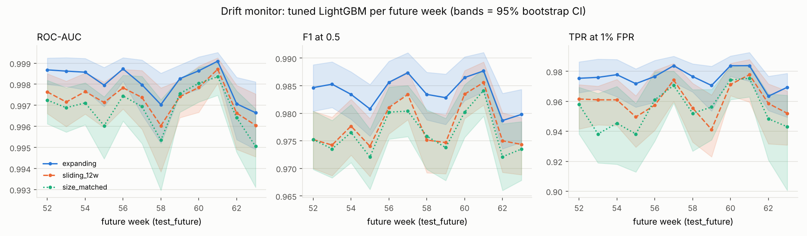

# Step 4 (part B): random vs temporal evaluation, bias, drift and the challenge set

Generated by `scripts/run_eval_bias.py` (stages fits, challenge, tables, writeup) from
`reports/predictions/*.npz` (the saved Step 2-3 test scores), the Step 4 fits in
`reports/predictions/eval/`, the saved models in `models/`, and the experiment log. Every number
below is read from `reports/tables/*.csv`; nothing is typed by hand.

**Machine.** Steps 2-3 ran on a 16-core laptop (Windows, 63 GB RAM). This step ran on a cloud VM:
4 vCPU, 15.7 GiB RAM, Linux-6.18.44-fc-v185-x86_64-with-glibc2.39, sharing the CPU with the SHAP job of Step 4,
so every Step 4 fit used 2 threads. Fit times are logged in
`reports/experiments.jsonl` but are **not** reported as benchmarks (they were measured under load,
on a different machine from Steps 2-3).

**Test-set discipline.** Nothing was selected, tuned, early-stopped or thresholded on
test_random or test_future. Every Step 4 fit uses `train` rows only, with the tuned
configuration and its fixed number of rounds (609 trees, from the
optuna search, which Step 2 selected by CV AUC). Thresholds come from TRAIN
out-of-fold scores. CIs: 1000 bootstrap resamples (seed 42) unless marked Wilson;
the two test sets are resampled independently, so a gap CI is (random) minus (future).

## 1. Random split vs future weeks (`reports/tables/random_vs_future.csv`)

All eight Step 2-3 models, scored on test_random (40k files from the same 52 weeks as train) and
test_future (40k files from the 12 later weeks). F1 and FPR are at the 0.5 threshold; AUC and
TPR@1%FPR do not need a threshold. Gap = random minus future (positive = the random split is
optimistic), with 95% CI.

| model | AUC random | AUC future | AUC gap [CI] | TPR@1%FPR random | TPR@1%FPR future | TPR gap [CI] | F1 random / future | FPR random / future |
|---|---|---|---|---|---|---|---|---|
| LightGBM default | 0.9978 | 0.9967 | 0.0011 [0.0006, 0.0016] | 96.5% | 95.1% | +1.39 pp [+0.75 pp, +2.02 pp] | 0.9789 / 0.9744 | 1.74% / 2.42% |
| LogReg | 0.9929 | 0.9297 | 0.0632 [0.0600, 0.0664] | 91.4% | 81.7% | +9.74 pp [+8.37 pp, +11.17 pp] | 0.9682 / 0.9172 | 3.15% / 3.92% |
| LightGBM grid | 0.9991 | 0.9980 | 0.0010 [0.0007, 0.0014] | 98.6% | 97.4% | +1.18 pp [+0.71 pp, +1.66 pp] | 0.9879 / 0.9827 | 0.99% / 1.41% |
| LightGBM random | 0.9990 | 0.9980 | 0.0011 [0.0007, 0.0014] | 98.4% | 97.5% | +0.98 pp [+0.60 pp, +1.41 pp] | 0.9872 / 0.9827 | 1.07% / 1.51% |
| LightGBM Optuna (tuned) | 0.9991 | 0.9981 | 0.0010 [0.0007, 0.0014] | 98.7% | 97.6% | +1.07 pp [+0.67 pp, +1.46 pp] | 0.9883 / 0.9838 | 1.04% / 1.32% |
| FLAML | 0.9986 | 0.9976 | 0.0011 [0.0007, 0.0015] | 97.9% | 96.5% | +1.39 pp [+0.83 pp, +1.85 pp] | 0.9845 / 0.9786 | 1.27% / 1.97% |
| AutoGluon | 0.9991 | 0.9980 | 0.0010 [0.0007, 0.0014] | 98.6% | 97.6% | +0.96 pp [+0.55 pp, +1.41 pp] | 0.9881 / 0.9834 | 1.03% / 1.45% |
| H2O AutoML | 0.9984 | 0.9970 | 0.0014 [0.0010, 0.0019] | 97.4% | 96.1% | +1.25 pp [+0.70 pp, +1.80 pp] | 0.9828 / 0.9771 | 1.59% / 2.53% |

- **Tree models lose little:** their AUC gaps are between 0.0010 and
  0.0014 (largest: H2O AutoML), and their TPR@1%FPR gaps
  between +0.96 pp and +1.39 pp.
  The AUC gap CI excludes zero for 7 of 7 tree models: the drop is real, but small.
- **LogReg loses much more:** AUC gap 0.0632 [0.0600, 0.0664], TPR@1%FPR gap
  +9.74 pp [+8.37 pp, +11.17 pp].
- **False alarms rise on future weeks** for 7 of 7 tree models at the 0.5 threshold
  (benign files of later weeks look more suspicious to the model): the cost of drift shows up in
  the FPR more than in the AUC.

## 2. Which CV predicts test_future better? (`reports/tables/cv_comparison.csv`)

The tuned configuration (fixed rounds, no early stopping) under two CV schemes on `train`:
- **stratified 3-fold**: the persisted shuffled folds (every fold mixes all 52 weeks);
- **forward 4-fold (week-blocked, expanding window)**: fit weeks 0-11, validate weeks 12-21; fit weeks 0-21, validate weeks 22-31; fit weeks 0-31, validate weeks 32-41; fit weeks 0-41, validate weeks 42-51.

The last two columns are the absolute error of each estimate against the test_future score of the
saved model. Std = across folds.

| estimate | folds | mean fit rows | AUC (± std) | TPR@1%FPR (± std) | |AUC - future| | |TPR - future| |
|---|---|---|---|---|---|---|
| stratified_3fold_cv | 3 | 106,667 | 0.9988 ± 0.0001 | 98.32% ± 0.04% | 0.0007 | 0.74 pp |
| forward_cv_4fold | 4 | 83,076 | 0.9975 ± 0.0013 | 96.61% ± 1.19% | 0.0006 | 0.98 pp |
| test_random | 0 |  | 0.9991 | 98.65% | 0.0010 | 1.07 pp |
| test_future | 0 |  | 0.9981 | 97.58% | 0.0000 | 0.00 pp |
| step2_tuning_cv (60k subset, early stopping) | 3 | 40,000 | 0.9978 ± 0.0002 | n/a | 0.0003 | n/a |

- Closer to test_future in AUC: **forward_cv_4fold**; in TPR@1%FPR: **stratified_3fold_cv**. The two schemes'
  errors differ by 0.0001 AUC and 0.24 pp TPR, against a test_future 95% CI
  half-width of 0.0003 AUC and 0.32 pp TPR: so neither scheme is clearly better.
- Direction: stratified CV is optimistic in AUC (0.9988 vs 0.9981) and optimistic in TPR@1%FPR (0.9832 vs 0.9758); forward CV is
  pessimistic in AUC (0.9975 vs 0.9981) and pessimistic in TPR@1%FPR (0.9661 vs 0.9758). Stratified CV mixes every week into every fold, like test_random.
- Per-fold forward values (oldest to newest validation block): AUC 0.9983 0.9955 0.9980 0.9982,
  TPR@1%FPR 0.9744 0.9483 0.9708 0.9707.
- Caveat: the forward folds also fit on fewer rows (mean 83,076 vs
  106,667), and their earliest fold sees only
  12 weeks, so part of their lower score is less data, not only time. Both CV schemes score models
  fit on less than all of train, while the test scores are of the model fit on all of it.

## 3. Why the tree models' gap is small: the evidence

**(a) The features DO drift, mostly in date-like columns.** Adversarial validation
(`gap_adversarial.csv`): a LightGBM (100 trees, 3-fold CV) tries to tell a sample of the train
split from other files, using X only (no labels). Neither side uses a test-set row.
- train split vs unused files of the same weeks 0-51 (control): AUC 0.4973;
- train split vs unused files of the future weeks 52-63: AUC **0.9383**.

Top 5 features of the second model (`gap_adversarial_top_features.csv`), with the rank the same
column has in the tuned detector (by gain, out of 2568):

| feature | column | time proxy | share of adversarial gain | rank in tuned LightGBM |
|---|---|---|---|---|
| header__0 | 696 | yes | 40.0% | 49 |
| section__140 | 910 |  | 16.7% | 1866 |
| authenticode__6 | 2478 | yes | 13.7% | 3 |
| header__10 | 706 |  | 0.6% | 22 |
| section__154 | 924 |  | 0.5% | 71 |

The 3 time-proxy columns hold 53.8% of the adversarial model's gain. So future files are
easy to recognise, mainly by when they were built or signed. The shift exists; the question is why
the detector does not suffer from it. Part of the answer is already in the last column: of these
5 date-revealing columns (71.6% of the adversarial gain), the detector ranks
1 in its own top 10 and 1 below rank 100.

**(b) The tuned LightGBM leans little on the most-drifting column, and cannot extrapolate the
others.** Time-proxy columns of X (`gap_time_proxies.csv`; indices from thrember's feature layout):

| column | index | gain rank in tuned LightGBM | gain share | future benign above train max | future malicious above train max | LogReg weight (standardized) |
|---|---|---|---|---|---|---|
| coff_timestamp | 696 | 49 | 0.18% | 0.0% | 0.0% | -0.060 |
| latest_signing_time | 2478 | 3 | 6.40% | 39.4% | 1.2% | -2.097 |
| signing_time_diff | 2479 | 2 | 8.00% | 0.6% | 0.1% | -0.041 |

- The COFF timestamp carries 40.0% of the adversarial model's gain but is only rank
  49 (0.18% of gain) in the detector, though mean |SHAP| on test_future ranks it 17 (`explainability.md`). Its training range
  already reaches year 2106 (some files carry build dates far in the
  future), so no future file lies above it.
- 39.4% of future benign files were signed after every
  training file. A tree sends such a value to the same leaf as the newest training values (a split
  has no slope), so these files are scored like the most recently signed training files. Evidence that
  this does no harm: at the train 1%-FPR threshold, benign FPR on signed files is
  0.23% on test_random and 0.19% on
  test_future (section 4a). A linear model instead adds
  weight x value without limit.

**(c) Where LogReg's separation goes** (`gap_logreg_shift.csv`). LogReg's logit is a sum over
columns, so its change from test_random to test_future splits exactly into feature families.
"Separation lost" = benign shift minus malicious shift (positive = the family pulls the classes
together), for the median file and for the mean. "Extreme" = share of files with a standardized
value beyond +-10 in that family (random / future). Top 5 families by the median, plus header (the top family by the mean):

| family | columns | separation lost (median) | separation lost (mean) | extreme files random / future |
|---|---|---|---|---|
| histogram | 256 | +0.757 | +0.905 | 6.40% / 20.14% |
| general | 7 | +0.229 | +0.071 | 0.61% / 0.29% |
| authenticode | 8 | +0.184 | +0.118 | 0.07% / 0.10% |
| byteentropy | 256 | +0.056 | +1.540 | 9.68% / 22.45% |
| exports | 129 | -0.004 | -0.057 | 1.83% / 1.34% |
| header | 74 | -0.573 | +49.757 | 3.10% / 16.98% |
| time proxies (3 cols, also inside header/authenticode) | 3 | +0.028 | +0.102 | 0.00% / 0.00% |

- For the typical file, **histogram** loses most separation (median +0.757).
- By the mean, **header** dominates (+49.757), but its median is -0.573: a few future files have standardized values up to 87,094,272 in this family (the column that loses most: header__16, col 712) and get huge, wrong logits. This is the extrapolation failure in action; a tree would cap those values.

- Out-of-range values become common: the share of files with a value beyond +-10 standard deviations grows from 10.6% to 22.8% in section; 9.7% to 22.5% in byteentropy; 6.4% to 20.1% in histogram (test_random to test_future). A tree puts any value beyond its last split
  into the same leaf; LogReg multiplies it by a fixed weight.

**(d) The time proxies are not LogReg's problem** (`gap_logreg_ablation.csv`): retrained without
the 3 time-proxy columns, its AUC gap is 0.0650 [0.0618, 0.0684], against 0.0632 [0.0600, 0.0664] with
them (-2.9% of the gap removed). The LogReg weight on the signing time is negative (later
signing = more benign), which on future benign files points the right way. LogReg drifts through
the many other columns of (c). For the tree models, the time-proxy ablation is in the leakage part
of Step 4 (`reports/leakage.md`).

**(e) No label shift.** The malicious share is 50.00% in train,
50.01% in test_random and 50.01% in test_future
(`class_balance.csv`; 50/50 in every single week, `class_balance_by_week.csv`). AUC and TPR@1%FPR
are per-class rates, so the gap is not a prevalence artefact. It also means neither test set says
anything about precision at a real-world base rate (section 4c).

**(f) Weekly stratification makes test_random an interpolation test.** test_random holds the same
weeks in the same proportions as train, so every test file has training files from its own week;
test_future files have none. The forward CV
of section 2 asks the same question inside train, and the drift monitor (section 5) shows how the
score moves week by week after the training period.

**In short:** the tuned LightGBM loses 0.0010 AUC from test_random to test_future
because (1) it gives little gain to the column that gives the date away most (COFF timestamp, gain
rank 49, SHAP rank 17; the stronger evidence is the time-proxy ablation in
`leakage.md`, which barely changes the gap), (2) its splits treat
out-of-range dates like the newest training dates instead of extrapolating them, (3) the class mix
does not change, and (4) 12 weeks is a short horizon (section 5). LogReg has no protection like
(2): its gap is 0.0632.

## 4. Bias and imbalance

### 4a. Per-slice detection and false-alarm rates (`bias_slices.csv`, `figures/bias_slices.png`)

Tuned LightGBM at the 1%-FPR threshold chosen on TRAIN out-of-fold scores (t = 0.5666; the CSV
also has 0.5 and the deployment threshold).
TPR is measured on the malicious files of a slice, FPR on its benign files, with 95% Wilson CIs;
"(small)" marks fewer than 100 files of that class. File-size quartile edges come from train:
174,572, 1,017,892, 4,248,132 bytes. Packer tags in EMBER2024 exist only on malicious
files (0 benign files are tagged in any split), so the packer slices have no FPR; the whole-file
entropy > 7 slice is a feature-based packing proxy that covers both classes.

| slice | TPR test_random | FPR test_random | TPR test_future | FPR test_future |
|---|---|---|---|---|
| file_size_quartile: Q1 | 97.7% [97.2%, 98.2%] n=3540 | 0.83% [0.64%, 1.09%] n=6352 | 96.7% [96.0%, 97.3%] n=2630 | 1.10% [0.89%, 1.36%] n=7648 |
| file_size_quartile: Q2 | 97.9% [97.4%, 98.3%] n=3845 | 0.79% [0.60%, 1.04%] n=6196 | 95.1% [94.1%, 95.9%] n=2195 | 0.92% [0.72%, 1.17%] n=7093 |
| file_size_quartile: Q3 | 99.2% [99.0%, 99.4%] n=6764 | 1.07% [0.77%, 1.49%] n=3269 | 97.4% [96.7%, 97.9%] n=3185 | 1.40% [1.07%, 1.83%] n=3716 |
| file_size_quartile: Q4 | 98.8% [98.5%, 99.0%] n=5855 | 1.27% [0.97%, 1.66%] n=4179 | 98.8% [98.6%, 99.0%] n=11993 | 2.86% [2.14%, 3.81%] n=1540 |
| packer_tag: packed (any) | 99.8% [99.5%, 99.9%] n=1773 | n/a | 99.1% [98.4%, 99.4%] n=1580 | n/a |
| packer_tag: not packed | 98.5% [98.3%, 98.6%] n=18231 | 0.95% [0.82%, 1.09%] n=19996 | 97.8% [97.6%, 98.0%] n=18423 | 1.23% [1.08%, 1.39%] n=19997 |
| packer_name: vmprotect | 99.7% [99.2%, 99.9%] n=1114 | n/a | 98.9% [98.1%, 99.4%] n=1005 | n/a |
| packer_name: themida | 100.0% [99.3%, 100.0%] n=552 | n/a | 99.6% [98.6%, 99.9%] n=501 | n/a |
| entropy_proxy: entropy > 7 | 99.6% [99.5%, 99.7%] n=10059 | 2.34% [1.71%, 3.18%] n=1670 | 99.4% [99.2%, 99.6%] n=7385 | 2.09% [1.55%, 2.81%] n=2011 |
| entropy_proxy: entropy <= 7 | 97.5% [97.2%, 97.8%] n=9945 | 0.82% [0.70%, 0.97%] n=18326 | 97.0% [96.7%, 97.3%] n=12618 | 1.13% [0.98%, 1.29%] n=17986 |
| signed: signed | 91.8% [90.1%, 93.2%] n=1203 | 0.23% [0.16%, 0.34%] n=11598 | 83.7% [81.3%, 85.9%] n=970 | 0.19% [0.12%, 0.29%] n=10732 |
| signed: unsigned | 99.0% [98.9%, 99.1%] n=18801 | 1.94% [1.67%, 2.26%] n=8398 | 98.6% [98.5%, 98.8%] n=19033 | 2.43% [2.13%, 2.76%] n=9265 |
| family: known | 98.9% [98.7%, 99.0%] n=15952 | n/a | 98.2% [98.0%, 98.4%] n=15803 | n/a |
| family: unknown | 97.4% [96.9%, 97.9%] n=4052 | n/a | 96.9% [96.3%, 97.4%] n=4200 | n/a |

- Highest benign FPR on test_future among slices with enough files: **file_size_quartile:
  Q4** at 2.86% (overall target on train: 1%).
- Lowest detection rate on test_future: **signed: signed** at
  83.7%.
- Largest change from test_random to test_future (slices with enough files in both): TPR falls most
  for **signed: signed** (-8.06 pp); benign FPR rises most for
  **file_size_quartile: Q4** (+1.59 pp). Drift is uneven: these slices lose
  far more than the -0.66 pp of the whole test set at this threshold.
- Per week (`bias_slices.csv`, slice_family = week): benign FPR ranges from 0.00%
  to 3.12% over the 52 test_random weeks and from 0.84% to
  1.86% over the 12 future weeks. One week holds only about
  385 benign files in test_random and 1667 in test_future, so
  a single week's FPR is noisy, in test_random most of all (Wilson upper bound
  0.99% even for its lowest week).

### 4b. Class weights (`class_weight.csv`)

Three refits of the tuned configuration on all of train on this machine, compared with the
unweighted refit (`class_weight_none`) on the same paired test_future resamples:
- `class_weight_balanced`: scale_pos_weight = n_benign/n_malicious = 1.000075;
- `class_weight_prior_10pct`: scale_pos_weight = 0.1111 (malware weighted as 10% of the data).

| model (test_future) | AUC | AUC diff vs none [CI] | TPR@1%FPR | TPR diff [CI] | F1 @0.5 | FPR @0.5 | TPR @0.5 | mean score benign / malicious |
|---|---|---|---|---|---|---|---|---|
| tuned (saved Step 2 model) | 0.9981 | +0.00000 [+0.00000, +0.00000] | 97.6% | +0.00 pp [+0.00 pp, +0.00 pp] | 0.9838 | 1.32% | 98.1% | 0.017 / 0.978 |
| class_weight_none | 0.9981 | +0.00000 [+0.00000, +0.00000] | 97.6% | +0.00 pp [+0.00 pp, +0.00 pp] | 0.9838 | 1.32% | 98.1% | 0.017 / 0.978 |
| class_weight_balanced | 0.9981 | -0.00001 [-0.00005, +0.00003] | 97.6% | -0.02 pp [-0.20 pp, +0.14 pp] | 0.9839 | 1.36% | 98.2% | 0.017 / 0.978 |
| class_weight_prior_10pct | 0.9980 | -0.00011 [-0.00021, -0.00002] | 97.4% | -0.19 pp [-0.33 pp, +0.04 pp] | 0.9819 | 0.97% | 97.4% | 0.011 / 0.971 |

- **Balanced weights did not help:** neither AUC nor TPR@1%FPR moves beyond its paired CI. At 50/50 the "balanced" weight is
  1.000075, i.e. no reweighting at all; the classes are
  balanced by construction, so there is no imbalance to correct.
- **Prior-matched weights did not help:** it lowers AUC by -0.00011 [-0.00021, -0.00002]. They mainly
  move the scores (mean benign / malicious score above): at the 0.5 cut-off FPR goes from 1.32% to
  0.97% and TPR from 98.1% to 97.4%.
  That is a threshold shift, which choosing the threshold directly does as well: reweighting adds
  no information about which files are malicious, so it cannot improve the ranking.
- The saved Step 2 model (fit with 16 threads) and the unweighted refit here (2 threads, Linux) give the same test_future AUC and TPR@1%FPR: the refit reproduces the saved model.

### 4c. Realistic prevalence: the base-rate effect (`prevalence.csv`)

Both test sets are 50/50, but most files a scanner sees are benign. From each model's TPR and
FPR on test_future: precision = pi*TPR / (pi*TPR + (1-pi)*FPR) and the counts per 10,000 files
scanned, at malware prevalence pi = 1%, 5%, 10%. The precision interval combines the Wilson
bounds of TPR and FPR in the worst and best direction (conservative). The CSV has every model.

| model | threshold | t | prevalence | TPR | FPR | precision [CI] | alarms / 10k | false alarms / 10k | missed / 10k |
|---|---|---|---|---|---|---|---|---|---|
| LogReg | 0.5 | 0.5000 | 1% | 88.0% | 3.92% | 18.5% [17.4%, 19.6%] | 476 | 388 | 12 |
| LogReg | 0.5 | 0.5000 | 5% | 88.0% | 3.92% | 54.2% [52.4%, 56.0%] | 812 | 372 | 60 |
| LogReg | 0.5 | 0.5000 | 10% | 88.0% | 3.92% | 71.4% [69.9%, 72.9%] | 1233 | 352 | 120 |
| LogReg | train_oof_1pct_fpr | 0.9204 | 1% | 81.4% | 0.95% | 46.4% [42.7%, 50.1%] | 175 | 94 | 19 |
| LogReg | train_oof_1pct_fpr | 0.9204 | 5% | 81.4% | 0.95% | 81.8% [79.5%, 83.9%] | 497 | 90 | 93 |
| LogReg | train_oof_1pct_fpr | 0.9204 | 10% | 81.4% | 0.95% | 90.5% [89.1%, 91.7%] | 900 | 86 | 186 |
| LightGBM Optuna | 0.5 | 0.5000 | 1% | 98.1% | 1.32% | 42.9% [39.9%, 45.9%] | 229 | 131 | 2 |
| LightGBM Optuna | 0.5 | 0.5000 | 5% | 98.1% | 1.32% | 79.6% [77.6%, 81.5%] | 616 | 125 | 10 |
| LightGBM Optuna | 0.5 | 0.5000 | 10% | 98.1% | 1.32% | 89.2% [88.0%, 90.3%] | 1100 | 119 | 19 |
| LightGBM Optuna | train_oof_1pct_fpr | 0.5666 | 1% | 97.9% | 1.23% | 44.7% [41.6%, 47.8%] | 219 | 121 | 2 |
| LightGBM Optuna | train_oof_1pct_fpr | 0.5666 | 5% | 97.9% | 1.23% | 80.8% [78.8%, 82.7%] | 606 | 116 | 10 |
| LightGBM Optuna | train_oof_1pct_fpr | 0.5666 | 10% | 97.9% | 1.23% | 89.9% [88.7%, 91.0%] | 1089 | 110 | 21 |
| LightGBM Optuna | deployment | 0.0069 | 1% | 99.5% | 7.43% | 11.9% [11.4%, 12.4%] | 835 | 736 | 0 |
| LightGBM Optuna | deployment | 0.0069 | 5% | 99.5% | 7.43% | 41.3% [40.1%, 42.6%] | 1203 | 706 | 2 |
| LightGBM Optuna | deployment | 0.0069 | 10% | 99.5% | 7.43% | 59.8% [58.6%, 61.0%] | 1664 | 669 | 5 |

At 1% prevalence the tuned LightGBM at its train 1%-FPR threshold raises
219 alarms per 10,000 files, 121 of them false:
precision 44.7%, against 98.8% on the 50/50 test set.
An analyst would see that many false alarms although the model has an AUC near 1.
- Threshold `0.5` (t = 0.5000): FPR 1.32%, TPR 98.1%, precision 42.9% at 1% prevalence, 131 false alarms per 10k (vs 121 at the 1%-FPR threshold).
- Threshold `deployment` (t = 0.0069): FPR 7.43%, TPR 99.5%, precision 11.9% at 1% prevalence, 736 false alarms per 10k (vs 121 at the 1%-FPR threshold).
- The deployment threshold minimises a 10:1 miss-to-false-alarm cost on 50/50 training data; at a realistic base rate false alarms dominate, so it would have to be re-derived for the prevalence of the place where the model is deployed.

## 5. Drift monitor (`drift.csv`, `figures/drift.png`)

Same tuned configuration, three training windows, scored on each future week 52-63 (about
3333 files per week; 95% bootstrap CIs per week):
- `expanding`: weeks 0-51, 160,000 rows (the saved Step 2 model);
- `sliding_12w`: only weeks 40-51, 36,924 rows (retrained on recent data);
- `size_matched`: 36,924 random rows of weeks 0-51 (same size as sliding, all weeks):
  sliding vs size_matched isolates "recent" from "less data".

| model | test set | AUC | F1 @0.5 | TPR@1%FPR |
|---|---|---|---|---|
| expanding | test_future | 0.9981 | 0.9838 | 97.6% |
| sliding_12w | test_future | 0.9973 | 0.9778 | 96.2% |
| size_matched | test_future | 0.9969 | 0.9765 | 95.6% |
| expanding | test_random | 0.9991 | 0.9883 | 98.7% |
| sliding_12w | test_random | 0.9970 | 0.9738 | 94.8% |
| size_matched | test_random | 0.9980 | 0.9805 | 97.0% |

- Weekly AUC of the expanding model ranges from 0.9966 (week
  63) to 0.9991. Least-squares slope:
  -0.00011 AUC per week (-0.0013 over the 12 weeks,
  against a random-vs-future gap of 0.0010); TPR@1%FPR -0.04 pp per week.
  The first future week already scores 0.9987 (test_random:
  0.9991), so the score keeps falling after the first future week; but the first and last weeks' CIs overlap, so the trend is only suggestive.
- sliding_12w vs expanding (paired per week): worse beyond its CI in 9 of 12 weeks, better
  in 0. Throwing away 40 weeks of history costs more than recency gains, at this horizon.
- sliding_12w vs size_matched (same number of rows): sliding has the higher AUC in 10 of
  12 future weeks; overall test_future AUC 0.9973 vs
  0.9969, TPR@1%FPR 96.2% vs
  95.6%. So at equal size recent data may be worth a little more than older data (suggestive only: no paired CI on this difference, one seed), but not enough to beat 4.3x more data.
- No model here is retrained on future weeks: retraining on labelled future data would be the
  real deployment remedy, but those labels are what test_future holds back.

## 6. Challenge set: malware that antivirus engines initially missed (`challenge.csv`)

EMBER2024's challenge set has 6,315 malicious files; 814 are
Win64 and were vectorised with the same thrember extractor and conventions (first copy of a sha256
wins: 0 duplicates; label filter: 0 dropped) into new files
`data/cache/X_challenge_win64.npy` + `meta_challenge_win64.parquet` (the main cache is untouched).
Overlap with our data: 0 files in the train split,
0 in the whole train cache, 0 in the test cache.
All are malicious, so the only metric is the detection rate (recall). Thresholds: 0.5 for every
model, the 1%-FPR threshold from TRAIN out-of-fold scores where such scores exist (tuned LightGBM,
default LightGBM, LogReg), and for the tuned LightGBM the deployment threshold:
models/threshold.json: cost-minimising on train OOF scores at C_FN/C_FP = 10.
Not scored: none. The challenge cache and scores were built on 16-CPU Windows (63.4 GiB RAM), the machine that holds every saved Step 2-3 model; scoring is deterministic, which the reload check below confirms. Each loaded model was checked against its saved test scores on the first
300 test_future rows (max abs difference: LightGBM default 0.0e+00, LightGBM grid 0.0e+00, LightGBM random 0.0e+00, LightGBM Optuna 0.0e+00, LogReg 1.3e-08, FLAML 0.0e+00, AutoGluon 0.0e+00, H2O AutoML 0.0e+00).

| model | threshold | t | detection rate [Wilson CI] | detected | TPR on ordinary test_future malware, same t | median score |
|---|---|---|---|---|---|---|
| LightGBM default | 0.5 | 0.5000 | 46.7% [43.3%, 50.1%] | 380/814 | 97.3% | 0.459 |
| LightGBM default | train_oof_1pct_fpr | 0.6668 | 33.3% [30.1%, 36.6%] | 271/814 | 96.1% | 0.459 |
| LightGBM grid | 0.5 | 0.5000 | 55.8% [52.3%, 59.2%] | 454/814 | 98.0% | 0.898 |
| LightGBM random | 0.5 | 0.5000 | 54.5% [51.1%, 57.9%] | 444/814 | 98.1% | 0.612 |
| LightGBM Optuna | 0.5 | 0.5000 | 55.7% [52.2%, 59.0%] | 453/814 | 98.1% | 0.725 |
| LightGBM Optuna | train_oof_1pct_fpr | 0.5666 | 53.7% [50.3%, 57.1%] | 437/814 | 97.9% | 0.725 |
| LightGBM Optuna | deployment | 0.0069 | 79.9% [77.0%, 82.5%] | 650/814 | 99.5% | 0.725 |
| LogReg | 0.5 | 0.5000 | 52.0% [48.5%, 55.4%] | 423/814 | 88.0% | 0.535 |
| LogReg | train_oof_1pct_fpr | 0.9204 | 24.0% [21.2%, 27.0%] | 195/814 | 81.4% | 0.535 |
| FLAML | 0.5 | 0.5000 | 50.6% [47.2%, 54.0%] | 412/814 | 97.7% | 0.517 |
| AutoGluon | 0.5 | 0.5000 | 55.0% [51.6%, 58.4%] | 448/814 | 98.1% | 0.662 |
| H2O AutoML | 0.5 | 0.5000 | 53.6% [50.1%, 57.0%] | 436/814 | 97.9% | 0.578 |

**Recall collapses.** At its train 1%-FPR threshold the tuned LightGBM detects
53.7% of the challenge files, against 97.9%
of ordinary test_future malware at the same threshold (-44.23 pp). At the same kind of threshold
(1% FPR on its own train out-of-fold scores) LightGBM default detects 33.3%, LogReg detects 24.0%. By period:

| subset (tuned LightGBM, train 1%-FPR threshold) | detection rate [CI] | n |
|---|---|---|
| all Win64 challenge | 53.7% [50.3%, 57.1%] | 814 |
| weeks 0-51 (training period) | 55.3% [51.5%, 59.1%] | 645 |
| weeks 52-63 (test_future period) | 47.3% [40.0%, 54.8%] | 169 |

These files evaded antivirus engines when first seen, and 46% of them also evade the
tuned static-feature model at its 1%-FPR threshold: the tuned model's test_future AUC of 0.9981 says
nothing about this hard tail.

## 7. Limits of this analysis

- One random seed (42) and one split per scheme; the CIs cover test-set sampling, not training
  randomness or a different choice of split.
- The forward CV and the drift windows confound recency with training-set size; the size-matched
  control addresses this for the drift monitor only.
- The 12 future weeks are a short horizon; drift over a year or more is likely larger.
- Slice CIs are Wilson intervals per slice, with no correction for looking at many slices.
- The challenge set is malicious only, so it measures misses, not false alarms.
