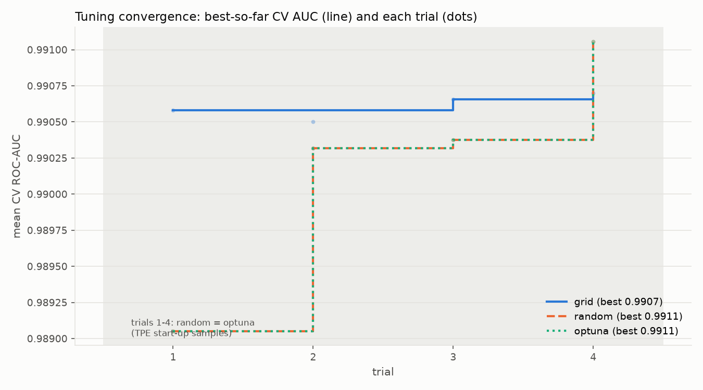

# Step 2 write-up: baselines and manual tuning of LightGBM

_Generated by `src/tuning_writeup.py` from the Step 2 tables (final evaluation run(s): 20261028T085758Z-e2731d, 20261028T093028Z-c62e97). Do not edit by hand: rerun `scripts/run_tuning.py --tables-only` to regenerate it._

## Methods

* **lgbm_default**: LightGBM with library defaults (100 trees, 31 leaves, learning rate 0.1). The "no tuning" reference.
* **logreg**: logistic regression on standardized features. A linear sanity floor.
* **grid**: Grid Search over `num_leaves` in [31, 127, 511], `learning_rate` in [0.03, 0.1, 0.3], `min_child_samples` in [20, 100], `feature_fraction` in [0.5, 1.0]; `bagging_fraction` and `lambda_l2` stay at LightGBM's defaults.
* **random**: Random Search, 4 seeded samples from `num_leaves` 16 to 512 (log), `learning_rate` 0.02 to 0.3 (log), `min_child_samples` 5 to 200 (log), `feature_fraction` 0.3 to 1, `bagging_fraction` 0.5 to 1, `lambda_l2` 1e-08 to 10 (log).
* **optuna**: Optuna TPE, 4 trials with a seeded sampler over the same space as Random Search.

All LightGBM models share the same fixed settings (`tune.BASE_PARAMS`: deterministic,
16 threads, seed 42).

### Equal budget

"Equal budget" means every tuner gets exactly 4 configurations, each scored by the
same 3 persisted CV folds of the same 5,000-row stratified tuning subset of `train`,
with the same cap of 2000 boosting rounds and early stopping after
50 rounds without improvement on each fold's validation part.
Wall-clock time is measured but not capped, because a time cap would make the result depend
on machine load while a trial count is exactly reproducible. Equal budget is therefore equal
*trials*, not equal *time* (see Timing). Random Search and Optuna also share their first
4 trials (TPE's random start-up phase, same seed), so they differ in only
0 of their 4 configurations.

Neither test set is used for any choice: the tuners only see the CV folds, and each method's
winner is scored once on `test_random` and once on `test_future`.

## Refit rule

Each tuner's best configuration is refit once on **all 8,000 rows of `train`**,
with a **fixed** number of trees: `n_estimators = round(mean of the winning trial's 3 fold best_iterations)`.
No hold-out and no early stopping are used in the refit.

| method | mean CV best_iteration | n_estimators used | train rows |
|---|---|---|---|
| grid | 581.3 | 581 | 8,000 |
| random | 478.7 | 479 | 8,000 |
| optuna | 478.7 | 479 | 8,000 |

**Why no scaling for the larger training set.** The CV training folds have
3,333 rows, the refit set 2 times more. The tuning logs cannot tell us the
right scale factor, because every fold they contain has the same size. Measuring it would need an extra
early-stopped CV of each winner on larger folds, which we did not run. Linear scaling would be a guess, and
it would ask for far more trees than any fold was allowed to explore (2000). Near its optimum
the validation AUC curve is flat (the fold best_iterations of one configuration often differ by hundreds of
rounds, see `tables/tuning_trials.csv`), so we assume the exact count matters little. We also *assume*, without
having tested it here, that more data moves the optimum towards more trees; if so, this rule gives slightly
too few trees. Either way the rule is the same for every tuner, so the comparison between tuners stays fair.

**What changed.** Refit version 1 used early stopping (patience 50) on a 10% hold-out
of `train`, so it fit on 7,200 rows (column `train rows fit` below) although its log said 8,000.
That stop was noisy: compare its `trees` column below with the mean CV best_iteration above. The test scores then measured the noisy refit, not the
tuner. Version 2 supersedes version 1: the version 1 records stay in the log and its models in
`models/refit_v1/` for transparency, and all other tables use version 2 only. The log is append-only, so a
version 1 record's `model_path` still names the file that now holds the version 2 model; column `model file`
below says where each version's model really is.

| method | refit version | strategy | trees | train rows fit | test_future AUC | test_future TPR@1%FPR | model file |
|---|---|---|---|---|---|---|---|
| grid | 1 | early stopping on internal 10% stratified hold-out of train | 272 | 7,200 | 0.9918 | 88.89% | `(not kept)` |
| grid | 2 | all of train, fixed n_estimators = round(mean CV fold best_iteration), no early stopping | 581 | 8,000 | 0.9925 | 89.69% | `models/lgbm_grid_quick.txt` |
| random | 1 | early stopping on internal 10% stratified hold-out of train | 244 | 7,200 | 0.9917 | 88.89% | `(not kept)` |
| random | 2 | all of train, fixed n_estimators = round(mean CV fold best_iteration), no early stopping | 479 | 8,000 | 0.9924 | 89.99% | `models/lgbm_random_quick.txt` |
| optuna | 1 | early stopping on internal 10% stratified hold-out of train | 244 | 7,200 | 0.9917 | 88.89% | `(not kept)` |
| optuna | 2 | all of train, fixed n_estimators = round(mean CV fold best_iteration), no early stopping | 479 | 8,000 | 0.9924 | 89.99% | `models/lgbm_optuna_quick.txt` |

## Results

CV AUC is the mean ± standard deviation over the 3 tuning folds. Test values are point estimates on
2,000 rows per test set, with **95% paired bootstrap confidence intervals** (1000 resamples;
seed 42 for `test_random`, seed 43 for `test_future`, independent streams so the gap CI below is valid; `src/eval.py: paired_bootstrap`). The CIs only capture test-set sampling noise: which files happened to land
in the test set. They do not capture training randomness (one seed, one fold split).

| method | CV AUC | test_random AUC [95% CI] | test_future AUC [95% CI] | test_random TPR@1%FPR [95% CI] | test_future TPR@1%FPR [95% CI] | test_future F1 |
|---|---|---|---|---|---|---|
| lgbm_default | 0.9892 ± 0.0010 | 0.9921 [0.9883, 0.9950] | 0.9916 [0.9879, 0.9948] | 89.02% [85.10%, 94.23%] | 90.09% [86.01%, 94.11%] | 0.9631 |
| logreg | 0.9695 ± 0.0027 | 0.9784 [0.9719, 0.9847] | 0.7599 [0.7335, 0.7858] | 70.56% [0.00%, 84.38%] | 45.75% [27.45%, 59.64%] | 0.7995 |
| grid | 0.9907 ± 0.0007 | 0.9932 [0.9900, 0.9958] | 0.9925 [0.9890, 0.9953] | 92.22% [89.05%, 94.67%] | 89.69% [85.76%, 94.61%] | 0.9642 |
| random | 0.9911 ± 0.0004 | 0.9924 [0.9887, 0.9952] | 0.9924 [0.9889, 0.9954] | 90.42% [85.11%, 94.84%] | 89.99% [85.95%, 94.25%] | 0.9635 |
| optuna | 0.9911 ± 0.0004 | 0.9924 [0.9887, 0.9952] | 0.9924 [0.9889, 0.9954] | 90.42% [85.11%, 94.84%] | 89.99% [85.95%, 94.25%] | 0.9635 |

**The tuners' CV AUC is slightly optimistic.** Each fold's early stopping picked its round on the same validation part that is then scored, and the reported value is the best of 4 trials. The baselines' CV AUC has neither bias (fixed number of rounds, one configuration). So the CV column is comparable among the three tuners, but not between tuners and baselines; the test scores are the unbiased comparison.

Full numbers: `tables/tuning_summary.csv`. Comparison figure: `figures/tuning_compare.png`.

## Which tuner won, and is it significant?

* **On CV** (what the tuners optimised), `random` is best. The three best CV AUCs lie within
  0.00036 of each other, which is smaller than the fold-to-fold standard deviation of the winner
  (0.00044).
* **On the test sets**, the paired bootstrap compares the methods on the same resampled rows, so a difference
  can be significant even when two CIs overlap.

| test set | metric | difference | value | 95% CI | resamples where a is better | significant |
|---|---|---|---|---|---|---|
| test_future | ROC-AUC | optuna − random | +0.00000 | [+0.00000, +0.00000] | 0.0% | no |
| test_future | ROC-AUC | optuna − grid | -0.00001 | [-0.00058, +0.00056] | 50.0% | no |
| test_future | ROC-AUC | random − grid | -0.00001 | [-0.00058, +0.00056] | 50.0% | no |
| test_future | TPR@1%FPR | optuna − random | +0.00 pp | [+0.00 pp, +0.00 pp] | 0.0% | no |
| test_future | TPR@1%FPR | optuna − grid | +0.30 pp | [-2.85 pp, +2.11 pp] | 41.0% | no |
| test_future | TPR@1%FPR | random − grid | +0.30 pp | [-2.85 pp, +2.11 pp] | 41.0% | no |
| test_random | ROC-AUC | optuna − random | +0.00000 | [+0.00000, +0.00000] | 0.0% | no |
| test_random | ROC-AUC | optuna − grid | -0.00090 | [-0.00172, -0.00007] | 1.6% | yes |
| test_random | ROC-AUC | random − grid | -0.00090 | [-0.00172, -0.00007] | 1.6% | yes |
| test_random | TPR@1%FPR | optuna − random | +0.00 pp | [+0.00 pp, +0.00 pp] | 0.0% | no |
| test_random | TPR@1%FPR | optuna − grid | -1.80 pp | [-5.77 pp, +1.33 pp] | 16.5% | no |
| test_random | TPR@1%FPR | random − grid | -1.80 pp | [-5.77 pp, +1.33 pp] | 16.5% | no |

**2 of 12 tuner-versus-tuner differences are significant at 95%:** `optuna` trails `grid` on test_random ROC-AUC (-0.00090, CI [-0.00172, -0.00007]); `random` trails `grid` on test_random ROC-AUC (-0.00090, CI [-0.00172, -0.00007]). The other differences are within test-set noise. With 12 uncorrected comparisons, about 0.6 would come out 'significant' by chance alone even if all tuners were equal, so one or two significant differences are weak evidence. The significant AUC differences are at most 0.00090, not smaller than the largest CV fold-to-fold standard deviation of the tuners (0.00069). Because the CIs do not include training randomness (one seed), a re-run with another seed could reorder the tuners; we read these as small differences.

**Tuning versus no tuning.** On test_future, 0 of 6 tuned-versus-default differences
are significant:

| comparison | metric | difference | 95% CI | significant |
|---|---|---|---|---|
| grid − lgbm_default | ROC-AUC | +0.00083 | [-0.00030, +0.00189] | no |
| grid − lgbm_default | TPR@1%FPR | -0.40 pp | [-2.92 pp, +3.24 pp] | no |
| random − lgbm_default | ROC-AUC | +0.00082 | [-0.00030, +0.00196] | no |
| random − lgbm_default | TPR@1%FPR | -0.10 pp | [-2.98 pp, +3.01 pp] | no |
| optuna − lgbm_default | ROC-AUC | +0.00082 | [-0.00030, +0.00196] | no |
| optuna − lgbm_default | TPR@1%FPR | -0.10 pp | [-2.98 pp, +3.01 pp] | no |

Full table, both test sets: `tables/tuning_pairwise.csv`.

## Timing

Procedure: all methods ran on the same machine, one after another, with LightGBM on
16 threads (`config.N_JOBS`), and we started the timed runs only when no other
heavy job was running. Machine load itself was not logged, so this is the procedure we followed, not a
measurement. The search times come from the original search run; a later `--refit-only` run re-measures
only the final fits.

| method | search seconds | search hours | seconds per trial | best trial (1-based) | final fit seconds |
|---|---|---|---|---|---|
| grid | 970 | 0.27 | 243 | 4 | 31 |
| random | 134 | 0.04 | 34 | 4 | 18 |
| optuna | 119 | 0.03 | 30 | 4 | 18 |

Baselines have no search; their final fits took `lgbm_default` 4 s, `logreg` 1 s. Equal trials did not mean equal time:
`grid` took longest, `optuna` was fastest. Time per trial depends on which configurations a method
visits (many leaves and a low learning rate are slow), not only on the method's own overhead, which is
negligible next to LightGBM training. **Caveat for every efficiency comparison:** Optuna's TPE sampler starts with 10 random start-up trials drawn with the same seed as Random Search. The log confirms the first 4 configurations of the two methods are identical, so they only differ in the remaining 0 of 4 trials. Any difference between Random and Optuna comes from those 0 trials alone.

## Convergence

The line is the best CV AUC found so far, the dots are individual trials. The grey band marks the trials that
Random Search and Optuna share. For Grid the curve only shows when the fixed grid order happens to reach good
points; it is not a search effect.

* `grid`: best CV AUC 0.9907 at trial 4; range over all trials 0.0002; no trial hit the round cap.
* `random`: best CV AUC 0.9911 at trial 4; range over all trials 0.0020; no trial hit the round cap.
* `optuna`: best CV AUC 0.9911 at trial 4; range over all trials 0.0020; no trial hit the round cap.

A trial "hit the round cap" when a fold's best round is later than 2000 − 50,
i.e. the cap and not early stopping ended training, so a higher cap might have scored that configuration higher
(column `hit_round_cap` in `tables/tuning_trials.csv`).

## Random split versus future weeks

Gap = score on `test_random` minus score on `test_future` (positive = the random split overstates). The two test
sets are resampled independently, so the gap CI is the spread of the difference of two independent estimates.

| method | AUC gap | 95% CI | TPR@1%FPR gap | 95% CI |
|---|---|---|---|---|
| lgbm_default | +0.00051 | [-0.00470, +0.00545] | -1.07 pp | [-6.40 pp, +6.32 pp] |
| logreg | +0.21844 | [+0.19167, +0.24582] | +24.81 pp | [-27.90 pp, +51.25 pp] |
| grid | +0.00079 | [-0.00388, +0.00556] | +2.53 pp | [-2.96 pp, +7.08 pp] |
| random | -0.00009 | [-0.00490, +0.00449] | +0.43 pp | [-6.50 pp, +6.46 pp] |
| optuna | -0.00009 | [-0.00490, +0.00449] | +0.43 pp | [-6.50 pp, +6.46 pp] |

For the LightGBM models the AUC gap is -0.0001 to +0.0008, and the TPR@1%FPR gap is
-1.07 to +2.53 percentage points. Not every tree model's AUC gap CI excludes zero. For logistic regression the AUC gap is +0.2184 and the TPR@1%FPR gap +24.8 percentage points.

The gaps are either large or not clearly different from zero, so no simple reading applies here. Step 4 looks at where any loss comes from (per-week drift plot, week-blocked forward CV, challenge set).
